<div align="center">


<<<<<<< HEAD
# CC Switch Classic
=======
### The All-in-One Manager for Claude Code, Claude Desktop, Codex, Gemini CLI, Grok Build, OpenCode, OpenClaw, Hermes Agent, Pi, MiniMax Code, Kimi Code & Oh My Pi
>>>>>>> v4.0.20

**V3 经典界面 × V4 现代内核**

*Classic V3-style UI on the cc-switch V4 core.*

[](https://github.com/jzcangshu/cc-switch-classic/releases)
[](https://github.com/farion1231/cc-switch)
[](#license)
[-9cf)](#下载与更新)

[下载最新版](https://github.com/jzcangshu/cc-switch-classic/releases/latest) · [更新日志](https://github.com/jzcangshu/cc-switch-classic/releases) · [上游项目](https://github.com/farion1231/cc-switch)

</div>

---

## 这是什么

[CC Switch](https://github.com/farion1231/cc-switch) 是一款管理 Claude Code / Codex 等 AI 编程工具供应商配置的桌面应用。官方 **V4 版**把界面全面改版成了侧栏布局。

**CC Switch Classic** 在**完全相同的 V4 内核**之上，把界面换回 V3 的经典样式——功能不缺，手感照旧。

两套界面长什么样、有什么区别，往下看图对比，挑一个顺手的用。

## 界面对比

以下截图均为真实程序界面，两个版本使用同一份数据，方便横向对比。

<<<<<<< HEAD
### ① 供应商首页
=======
<tr>
<td width="180"><a href="https://runapi.host/register?aff=iOKB"></a></td>
<td>Thanks to RunAPI for sponsoring this project! RunAPI is a high-performance and reliable AI model API gateway — one API key gives you access to 150+ mainstream models including OpenAI, Claude, Gemini, DeepSeek, and Grok, with prices as low as 10% of the official rate and excellent stability. It works seamlessly with Claude Code, OpenClaw, and other tools. Exclusive benefit for CC Switch users: register via <a href="https://runapi.host/register?aff=iOKB">this link</a> and enjoy a 10% discount on your first top-up!</td>
</tr>

<tr>
<td width="180"><a href="https://www.openmodel.ai?ref=cc-switch">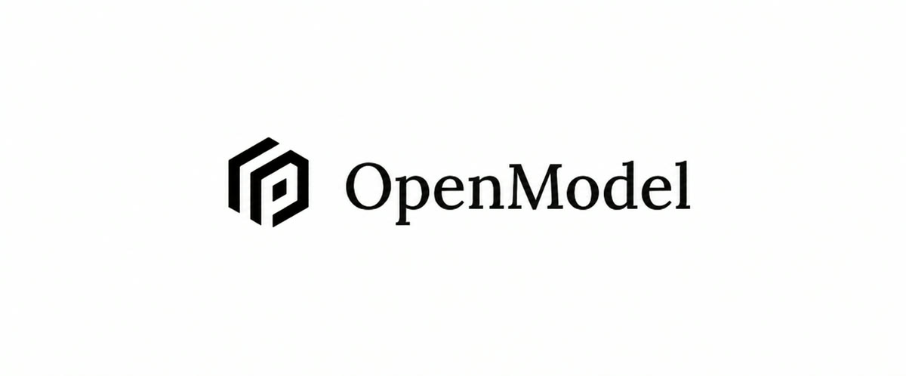</a></td>
<td>Thanks to OpenModel for sponsoring this project! OpenModel offers client-specific discounts of up to 90% for Codex and 60% for Claude Code across supported models, helping developers cut API costs without changing how they work. Just connect your OpenModel API key and keep using Codex or Claude Code as usual — supported clients are detected automatically and discounted routes are applied with no extra parameters or manual routing required. You can also configure fallback behavior per API key, choosing whether to continue at standard pricing or stop when a discounted route is temporarily unavailable. CC Switch users can register via <a href="https://www.openmodel.ai?ref=cc-switch">this link</a> and use promo code <strong>"cc-switch"</strong> to get 10% off their first top-up.</td>
</tr>

<tr>
<td width="180"><a href="https://grooroute.pro/sign-up?aff=qqm9">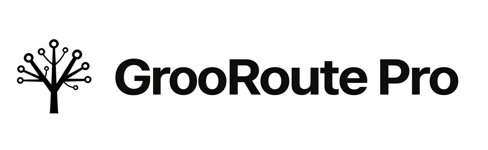</a></td>
<td>Thanks to GrooRoute Pro for sponsoring this project! GrooRoute Pro is a reliable, smooth AI API relay platform with access to OpenAI, Claude, DeepSeek, and other mainstream models. Deployed on overseas servers, it lets you choose your own pricing-multiplier tier and offers both pay-as-you-go billing and subscription plans, so you can use it however suits you best — with stable routes and fast responses that make calling all kinds of AI capabilities easier. Exclusive benefit for CC Switch users: register via <a href="https://grooroute.pro/sign-up?aff=qqm9">this link</a> to get ¥5 in free trial credit!</td>
</tr>

<tr>
<td width="180"><a href="https://dit.ai?utm_source=ccswitch">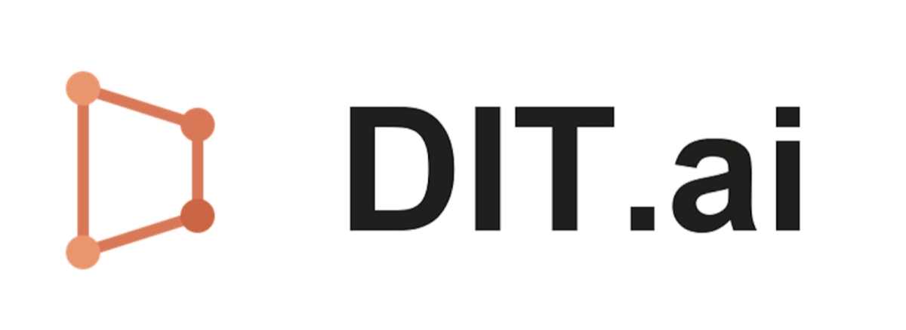</a></td>
<td>Thanks to DIT.ai for sponsoring this project! DIT.ai is an AI token exchange and marketplace for lower-cost multi-provider routing. It gives developers access to 50+ leading AI models — including GPT, Claude, Gemini, DeepSeek, Grok, Llama, and more across text, image, video, and audio — through one OpenAI-compatible API. Qualified providers compete for each request across 160+ routes, and DIT selects the best available price-to-quality option in real time, typically 30–70% below official list pricing. Built for developers, startups, and teams running agents or AI products at scale: change your base URL and API key, keep your existing stack, and start calling models with automatic routing and failover. CC Switch users can register via <a href="https://dit.ai?utm_source=ccswitch">this link</a> and use promo code <strong>ccswitch</strong> to claim a $5 welcome coupon!</td>
</tr>

<tr>
<td width="180"><a href="https://buytoken.work/sign-up?aff=cc-switch">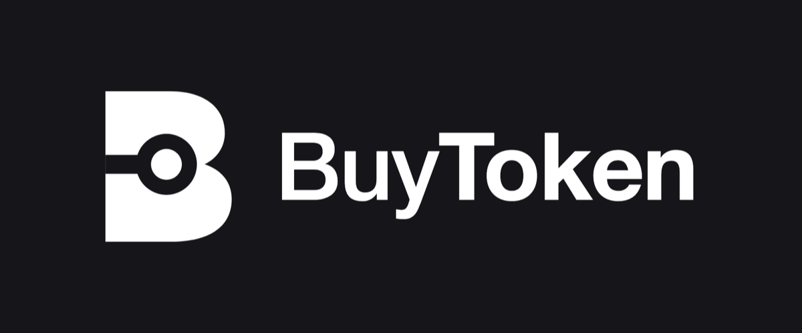</a></td>
<td>Thanks to BuyToken for sponsoring this project! BuyToken offers relay services for Claude Code, Codex, DeepSeek, and more, with enterprise-grade concurrency and fast invoicing — built to be a stable, long-running service. BuyToken also offers CC Switch users a special deal: register via <a href="https://buytoken.work/sign-up?aff=cc-switch">this link</a> to get ¥3 in trial credit, plus 10% off your first top-up!</td>
</tr>

<tr>
<td width="180"><a href="https://gpt.ge/signup?aff=URNP"></a></td>
<td>Thanks to V-API for sponsoring this project! V-API is a three-year-old brand dedicated to providing individuals, developers, and businesses with a stable, fast, and secure platform for high-quality LLM API services, with support for formal contracts and official invoices (general / special VAT). V-API offers CC Switch users a special deal: register via <a href="https://gpt.ge/signup?aff=URNP">this link</a> to get ¥2 off plus 10% off your first order!</td>
</tr>

<tr>
<td width="180"><a href="https://agentmarket.fluxapay.xyz/marketplace/tokenplans">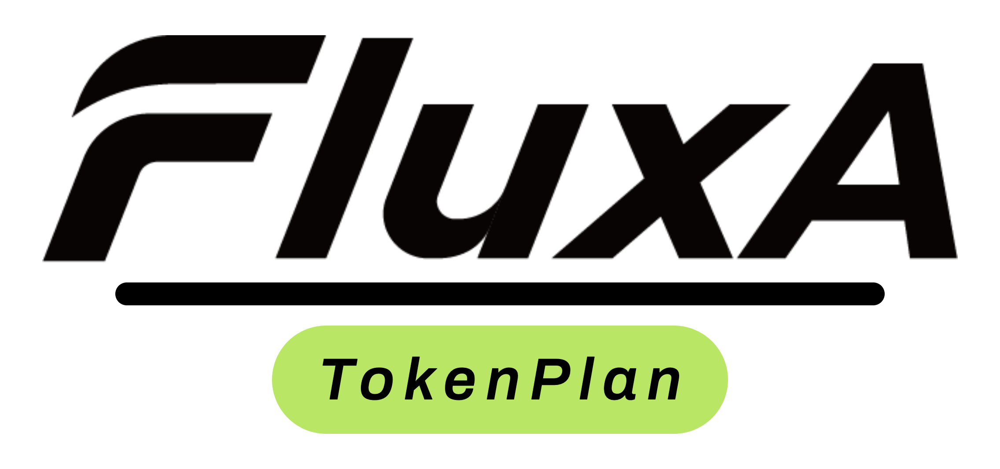</a></td>
<td>Thanks to FluxA &amp; Baidu AI Cloud for sponsoring this project! FluxA and Baidu AI Cloud jointly launched AgenticPlan, which gives AI agents the ability to buy, manage and use models, APIs and tools on their own. It includes Baidu Qianfan TokenPlan at up to 40% off, with access to flagship models such as DeepSeek V4, GLM 5.2 and Kimi, plus bonus FluxA AgentMarket API credits that unlock 13,000+ paid APIs for search, data scraping, social media, finance, crypto, image generation, video and more.<br>With the user's authorization, an AI agent can also pay with the official Visa card to procure resources on its own, manage API keys, monitor usage and plan renewals — taking agents from "completing tasks autonomously" to genuinely "planning their own budget and completing tasks". Buy via <a href="https://agentmarket.fluxapay.xyz/marketplace/tokenplans">this link</a>!</td>
</tr>

<tr>
<td width="180"><a href="https://aigocode.net/invite/CC-SWITCH">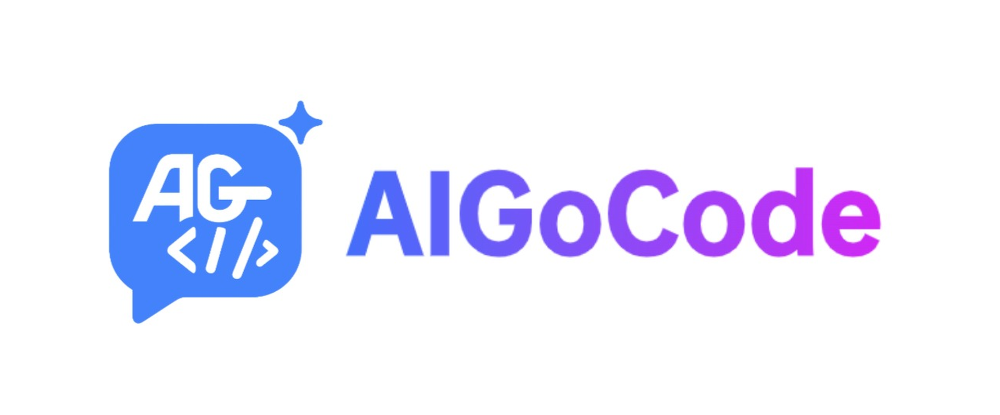</a></td>
<td>Thanks to AIGoCode for sponsoring this project! AIGoCode is an all-in-one platform that integrates Claude Code, Codex, and the latest Gemini models, providing you with stable, efficient, and highly cost-effective AI coding services. The platform offers flexible subscription plans, zero risk of account suspension, direct access with no VPN required, and lightning-fast responses. AIGoCode has prepared a special benefit for CC Switch users: if you register via <a href="https://aigocode.net/invite/CC-SWITCH">this link</a>, you'll receive an extra 10% bonus credit on your first top-up!</td>
</tr>

<tr>
<td width="180"><a href="https://aicoding.inc/i/CCSWITCH"></a></td>
<td>Thanks to AICoding for sponsoring this project! AICoding — Global AI Model API Relay Service at Unbeatable Prices! Claude Code at 19% of original price, GPT at just 1%! Trusted by hundreds of enterprises for cost-effective AI services. Supports Claude Code, GPT, Gemini and major domestic models, with enterprise-grade high concurrency, fast invoicing, and 24/7 dedicated technical support. CC Switch users who register via <a href="https://aicoding.inc/i/CCSWITCH">this link</a> get 10% off their first top-up!</td>
</tr>

<tr>
<td width="180"><a href="https://subrouter.ai/register?aff=l3ri">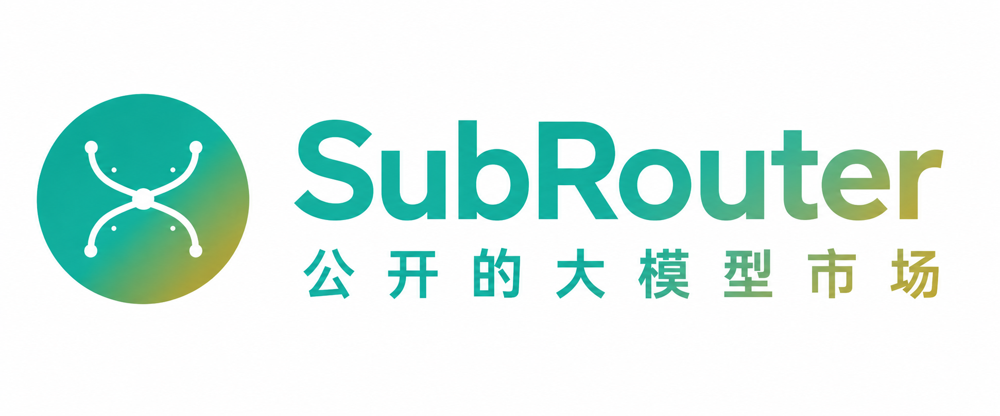</a></td>
<td>Thanks to SubRouter for sponsoring this project! SubRouter is a marketplace and smart routing platform for AI service operators. Merchants can launch operating sites, publish packages, manage users, models, and pricing, while users discover services and access reliable AI models through one unified API. Register via <a href="https://subrouter.ai/register?aff=l3ri">this link</a>!</td>
</tr>

<tr>
<td width="180"><a href="https://www.shengsuanyun.com/?from=CH_4HHXMRYF">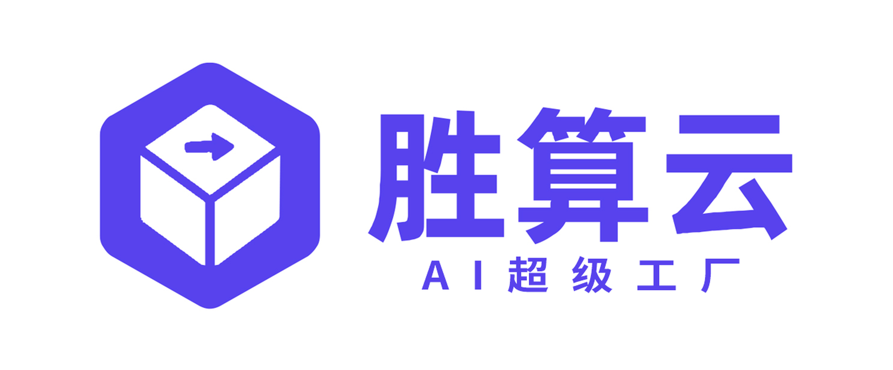</a></td>
<td>Thanks to Shengsuanyun for sponsoring this project! Shengsuanyun is a super factory serving AI Native Teams — an industrial-grade AI task parallel execution platform. Its model marketplace aggregates Claude, ChatGPT, Gemini, and other domestic and international LLM and multimedia model capabilities with direct supply. Absolutely no reverse engineering or dilution — platform-wide model SLA availability reaches 99.7%, with <a href="https://watch.shengsuanyun.com/status/shengsuanyun">monitoring dashboards</a> showing green across the board. It also offers enterprise-grade custom gateways for fine-grained team cost and permission management, smart routing, security protection, and BYOK (Bring Your Own Key) hosting. The platform charges on a pay-per-use and tokens plan (coming soon) basis, with invoicing available. Register via <a href="https://www.shengsuanyun.com/?from=CH_4HHXMRYF">this link</a> as a new user to receive ¥10 in credits plus a 10% bonus on your first top-up.</td>
</tr>

<tr>
<td width="180"><a href="https://88api.ai/sign-up?aff=HSGY">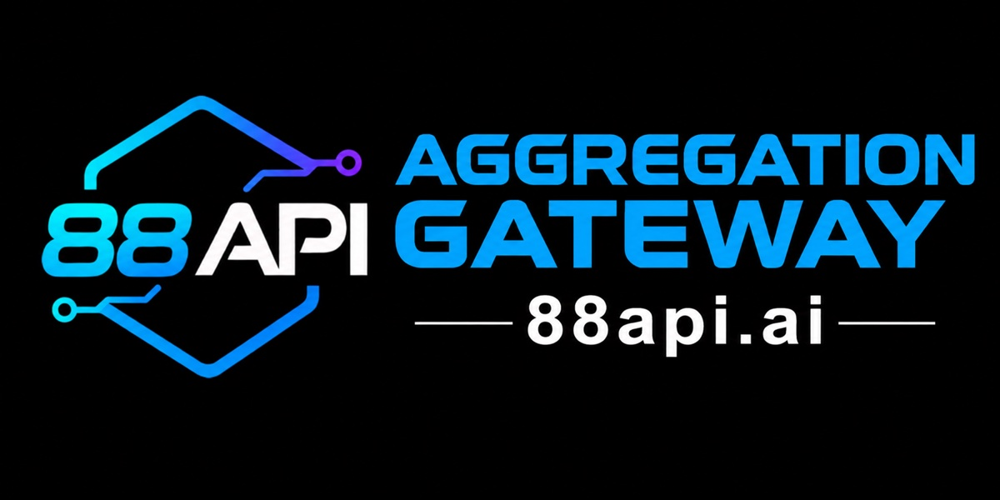</a></td>
<td>Thanks to 88API Token Aggregation Platform for sponsoring this project! 88API is a one-stop multi-model API platform operated by a Hong Kong company, built mainly for developers, creators and AI application users. A unified interface gives access to text, image, speech and video models, covering common workflows such as AI coding, smart translation, content creation, voice-over, image generation and video generation. You can add it as a provider and switch to it right inside CC Switch. 88API supports major international payment methods, can issue invoices, and provides enterprise-grade stable service. Register via <a href="https://88api.ai/sign-up?aff=HSGY">this link</a> to receive exclusive bonus credits!</td>
</tr>

<tr>
<td width="180"><a href="https://apikey.fan/register?aff=CCSwitch">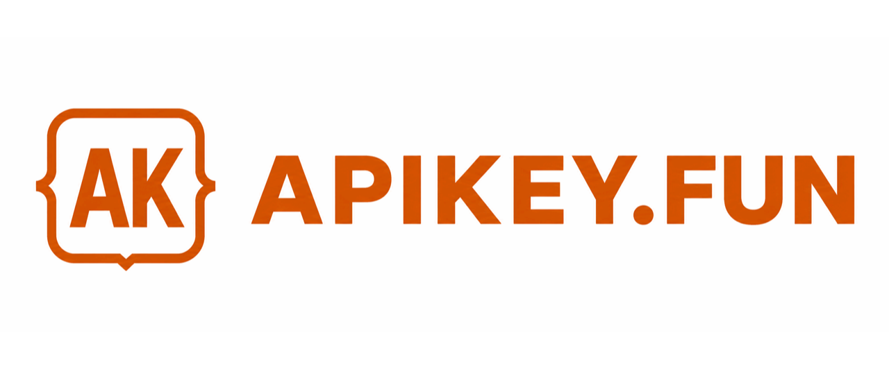</a></td>
<td>Thanks to APIKEY.FUN for sponsoring this project! APIKEY.FUN is a professional enterprise-grade AI relay platform dedicated to providing stable, efficient, and low-cost AI model API access for enterprises and individual developers. The platform supports popular mainstream models such as Claude, OpenAI, and Gemini, with prices as low as 7% of official rates. Register through this project's <a href="https://apikey.fan/register?aff=CCSwitch">exclusive link</a> to enjoy an exclusive offer of up to <strong>permanent 5% off top-ups</strong>.</td>
</tr>

<tr>
<td width="180"><a href="https://9527.codes/register?aff=e5zI"></a></td>
<td>Thanks to 9527CODE for sponsoring this project! 9527 CODE is an enterprise-grade, full-capability AI relay platform focused on stability and service quality, providing fast, stable, and high-quality relay services for Claude Code, Codex, and other mainstream AI models. It places greater emphasis on long-term stability, route quality, and sustained availability, offering enterprises and heavy AI users a stable and efficient one-stop model access solution. With one year of continuous operation, 99.9% service stability, and 7×24 human technical support. Register through this project's <a href="https://9527.codes/register?aff=e5zI">exclusive link</a>; new users can contact customer service to receive trial credit, and referral cashback is unlimited!</td>
</tr>

<tr>
<td width="180"><a href="https://teamorouter.cn/?utm_source=cc_switch&utm_medium=referral&utm_campaign=ai_directory">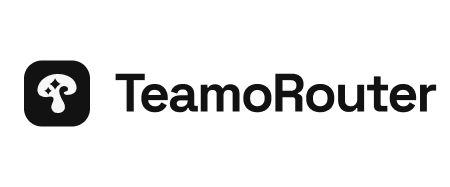</a></td>
<td>Thanks to TeamoRouter for sponsoring this project! TeamoRouter is an enterprise-grade Agentic LLM gateway built for developers, AI teams, and businesses. Without requiring any subscriptions, it lets you access Claude Code, Codex, Gemini CLI, OpenAI Codex, and other popular AI agents through a single unified API, while offering API pricing at discounts of up to 90%.
Unlike typical API relay services, TeamoRouter aggregates hundreds of official model providers and trusted infrastructure partners, including OpenAI, Anthropic, Vertex, Azure, and AWS bedrock. Every provider is verified for 100% Agent protocol compatibility, cache performance, and request traceability, ensuring stable quality instead of reverse-engineered or diluted endpoints. The platform delivers near-official TTFT, 99.6% SLA, enterprise-scale throughput up to 5,000 QPM, and industry-leading cache hit rates that dramatically reduce token costs for long-running agent workflows.
TeamoRouter also offers enterprise features including centralized billing, team management, BYOK, smart routing, usage analytics, dynamic provider optimization, and dedicated support. For an even simpler experience, Teamo Desktop lets you use Claude Code, Codex, Gemini CLI, and other popular AI agents with one-click setup—no API key management or manual gateway configuration required. Register via <a href="https://teamorouter.cn/?utm_source=cc_switch&utm_medium=referral&utm_campaign=ai_directory">this link</a> as a new user to receive 10% off your first top-up.</td>
</tr>

<tr>
<td width="180"><a href="https://ppio.com/activity/ccswitch">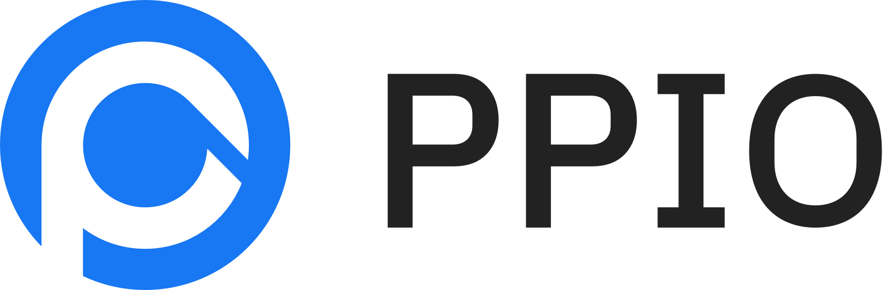</a></td>
<td>Thanks to PPIO for sponsoring this project! PPIO is a leading independent Agentic Cloud provider in China, co-founded in 2018 by PPTV founder Yao Xin and former PPTV chief architect Wang Wenyu. A single API key gives you access to every flagship open-source model, including DeepSeek-V4-Flash, Kimi-K3, GLM-5.2, and MiniMax-M3; the enterprise Token Plan is available at up to 40% off and supports 200 seats, and the Fusion blended model matches Fable5 at one-tenth of the price. Register via <a href="https://ppio.com/activity/ccswitch">this link</a> and complete identity verification to receive a ¥10 credit voucher — invite friends to top up and earn up to 15% cashback on their spend.</td>
</tr>

<tr>
<td width="180"><a href="https://www.newapi.ai/">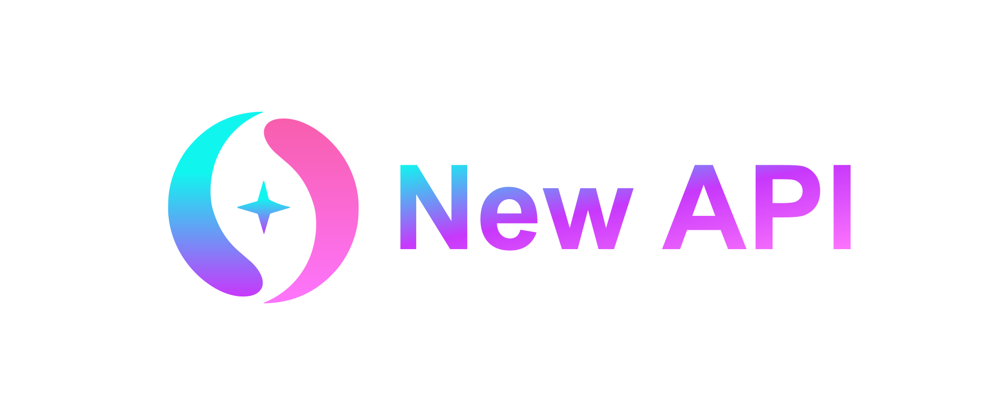</a></td>
<td>Thanks to the open-source AI infrastructure project <a href="https://www.newapi.ai/">new-api</a> for its strong support of this project! new-api is an open-source AI infrastructure project from QuantumNous and one of the leading unified LLM access-and-distribution projects by activity and adoption, focused on helping developers, teams, and enterprises build manageable, scalable AI service platforms at lower cost. As a fellow project rooted in the open-source ecosystem, new-api hopes to sponsor and support the continued growth of more outstanding open-source projects. 🌟 Star new-api to show your support: <a href="https://github.com/QuantumNous/new-api">https://github.com/QuantumNous/new-api</a>. Website: <a href="https://www.newapi.ai/">https://www.newapi.ai/</a>.</td>
</tr>

<tr>
<td width="180"><a href="https://claudecn.ai/register?aff=HEL9"></a></td>
<td>Thanks to ClaudeCN for sponsoring this project! ClaudeCN is an enterprise-grade AI gateway platform operated by a registered company. It delivers high-availability commercial API access to popular models including Claude, GPT, and DeepSeek, and is built around formal enterprise procurement workflows — corporate bank transfers, signed contracts, and full compliance. Register via <a href="https://claudecn.ai/register?aff=HEL9">this link</a>!</td>
</tr>

<tr>
<td width="180"><a href="https://www.byteplus.com/en/product/modelark?utm_campaign=hw&utm_content=ccswitch&utm_medium=devrel_tool_web&utm_source=OWO&utm_term=ccswitch"></a></td>
<td>Thanks to Dola seed for sponsoring this project! Dola Seed 2.0 is a full‑modal general large model independently developed by ByteDance for the global market. Built on a unified multimodal architecture, it supports joint understanding and generation of text, images, audio, and video. It natively enables agent collaboration, with strong reasoning, long‑task execution, tool integration, and coding capabilities. It is widely applicable to smart cockpits, personal assistants, education, customer support, marketing, retail, and other scenarios. It excels in multimodal perception, end‑to‑end complex task delivery, stable interaction, and data security, and is readily accessible and deployable via the ModelArk platform. Register via <a href="https://www.byteplus.com/en/product/modelark?utm_campaign=hw&utm_content=ccswitch&utm_medium=devrel_tool_web&utm_source=OWO&utm_term=ccswitch">this link</a> to get 500,000 tokens of free inference quota per model.<a href="https://www.volcengine.com/activity/ai618?utm_campaign=hw&utm_content=hw&utm_medium=devrel_tool_web&utm_source=OWO&utm_term=ccswitch"> >>中国大陆地区的开发者请点击这里</a></td>
</tr>

<tr>
<td width="180"><a href="https://cloud.siliconflow.cn/i/YflgU2Ve"></a></td>
<td>Thanks to SiliconFlow for sponsoring this project! SiliconFlow is a high-performance AI infrastructure and model API platform, providing fast and reliable access to language, speech, image, and video models in one place. With pay-as-you-go billing, broad multimodal model support, high-speed inference, and enterprise-grade stability, SiliconFlow helps developers and teams build and scale AI applications more efficiently. Register via <a href="https://cloud.siliconflow.cn/i/YflgU2Ve">this link</a> and complete real-name verification to receive ¥16 in bonus credit, usable across models on the platform. SiliconFlow is also now compatible with OpenClaw, allowing users to connect a SiliconFlow API key and call major AI models for free.</td>
</tr>

<tr>
<td width="180"><a href="https://a6api.com/register?aff=AqNr">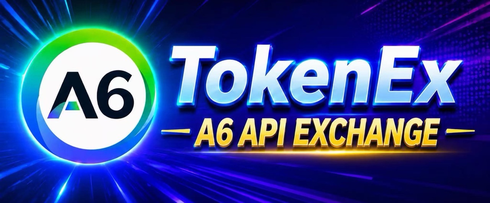</a></td>
<td>Thanks to <a href="https://a6api.com/register?aff=AqNr">A6API</a> for sponsoring this project! A6API is a one-stop AI model API aggregation platform covering Claude, GPT, Gemini, Codex, and other mainstream models. Multiple vendors can list their supply on the platform, so the same model can be quoted competitively by several upstream providers. Smart routing automatically picks the more stable, lower-priced route available and fails over automatically, helping you reduce failed requests, cut costs, and improve stability. Whether you are an individual developer, an AI product team, or a studio, you can integrate quickly through a unified interface — compatible with all formats, with low migration cost. New users who register via <a href="https://a6api.com/register?aff=AqNr">this link</a> receive free trial credits: try it first, then use it at a low price.</td>
</tr>

<tr>
<td width="180"><a href="https://www.compshare.cn/coding-plan?ytag=GPU_YY_YX_git_cc-switch">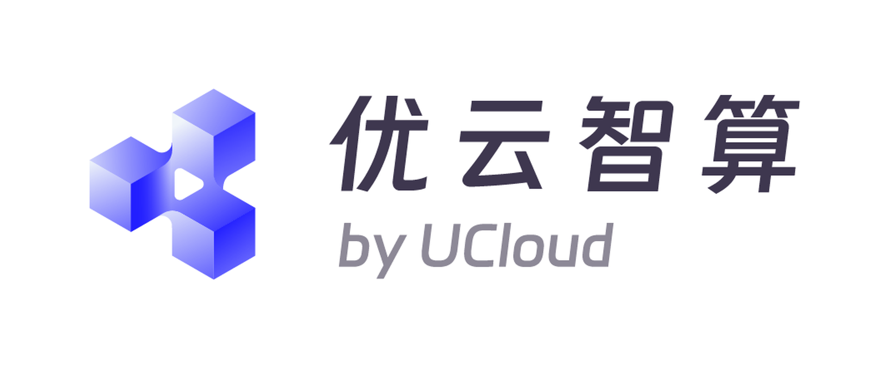</a></td>
<td>Thanks to Compshare for sponsoring this project! Compshare is UCloud's AI cloud platform, providing stable and comprehensive domestic and international model APIs with just one key. Featuring cost-effective monthly and per-use domestic-model Coding Plan packages, alongside stable officially-relayed overseas models. Supports Claude Code, Codex, and API access. Enterprise-grade high concurrency, 24/7 technical support, and self-service invoicing. Users who register via <a href="https://www.compshare.cn/coding-plan?ytag=GPU_YY_YX_git_cc-switch">this link</a> will receive a free 5 CNY platform trial credit!</td>
</tr>

<tr>
<td width="180"><a href="https://www.ccsub.net/register?ref=Y6Z8DXEA"></a></td>
<td>Thanks to CCSub for sponsoring this project! CCSub is a stable, affordable AI API relay platform — your drop-in replacement for a Claude.ai subscription. One API key gives you access to Claude Opus 4.8, Sonnet, Haiku, GPT-5, Gemini, and DeepSeek at roughly 30% of direct API cost, with no VPN required from anywhere in the world. Compatible with Claude Code, Codex, Cursor, Cline, Continue, Windsurf, and all major AI coding tools. Register via <a href="https://www.ccsub.net/register?ref=Y6Z8DXEA">this link</a> and get $5 free credit on sign-up.</td>
</tr>

<tr>
<td width="180"><a href="https://sssaicodeapi.com/register?ref=DCP0SM"></a></td>
<td>Thanks to SSSAiCode for sponsoring this project! SSSAiCode is a stable and reliable API relay service, dedicated to providing stable, reliable, and affordable Claude and Codex model services, with same-day fast invoicing. SSSAiCode offers a special deal for CC Switch users: register via <a href="https://sssaicodeapi.com/register?ref=DCP0SM">this link</a> to enjoy $10 extra credit on every top-up!</td>
</tr>

<tr>
<td width="180"><a href="https://soleapi.com/r/ccswitch"></a></td>
<td>Thanks to SoleAPI for supporting this project! SoleAPI is an AI model gateway for developers and enterprises: one API key gives you access to 30+ leading models including Claude, GPT and Gemini. It is natively compatible with the OpenAI and Anthropic protocols, so Claude Code, Codex, Cursor and your existing SDKs work by simply changing the Base URL. Requests are routed in real time by latency and upstream health, with millisecond-level automatic failover to backup channels, 99.99% service availability and 24/7 technical support. Every call lands on a single bill with per-request token and cost breakdowns you can inspect at any time. Sign up through this project's <a href="https://soleapi.com/r/ccswitch">referral link</a> to receive free trial credits, and earn ongoing cashback by inviting friends who top up!</td>
</tr>

<tr>
<td width="180"><a href="https://www.micuapi.ai/register?aff=aOYQ">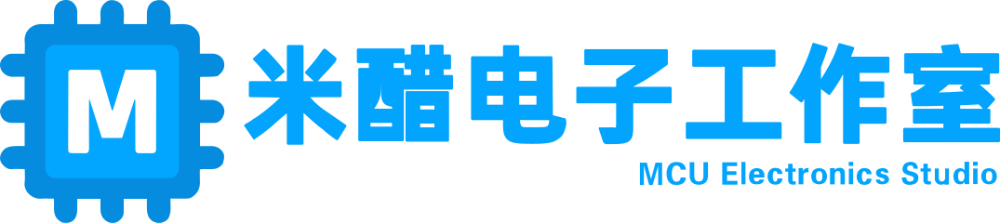</a></td>
<td>Thanks to Micu API for sponsoring this project! Micu API is a global LLM relay service provider dedicated to delivering the best cost-performance ratio with high stability. Backed by a registered enterprise for core assurance, eliminating any risk of service discontinuation, with fast official invoicing support! We champion "zero cost to try": top up from as low as ¥1 with no minimum, and get fee-free refunds anytime! Micu API offers an exclusive deal for CC Switch users: register via <a href="https://www.micuapi.ai/register?aff=aOYQ">this link</a> and enter promo code "ccswitch" when topping up to enjoy a <strong>10% discount</strong>!</td>
</tr>

<tr>
<td width="180"><a href="https://www.rightapi.ai/register?aff=CCSWITCH"></a></td>
<td>Thank you to Right Code for sponsoring this project! Right Code reliably provides routing services for models such as Claude Code, Codex, and Gemini, with both pay-as-you-go and monthly subscription billing options available. Invoices are available upon top-up, and enterprise and team users can receive dedicated one-on-one support. Right Code also offers an exclusive discount for CC Switch users: register via <a href="https://www.rightapi.ai/register?aff=CCSWITCH">this link</a>, and with every top-up you will receive pay-as-you-go credit equivalent to 5% of the amount paid.</td>
</tr>

<tr>
<td width="180"><a href="https://cubence.com/signup?code=CCSWITCH&source=ccs">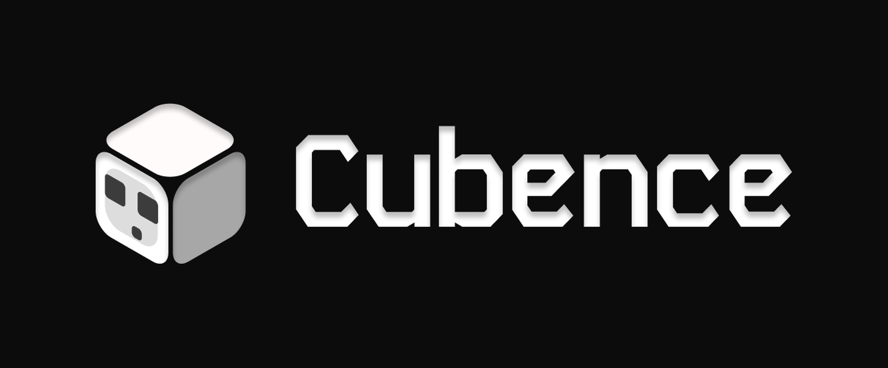</a></td>
<td>Thanks to Cubence for sponsoring this project! Cubence is a reliable and efficient API relay service provider, offering relay services for Claude Code, Codex, Gemini, and more with flexible billing options including pay-as-you-go and monthly plans. Cubence provides special discounts for CC Switch users: register using <a href="https://cubence.com/signup?code=CCSWITCH&source=ccs">this link</a> and enter the "CCSWITCH" promo code during recharge to get 10% off every top-up!</td>
</tr>

<tr>
<td width="180"><a href="https://crazyrouter.com/register?aff=OZcm&ref=cc-switch"></a></td>
<td>Thanks to Crazyrouter for sponsoring this project! Crazyrouter is a high-performance AI API aggregation platform — one API key for 300+ models including Claude Code, Codex, Gemini CLI, and more. All models at 55% of official pricing with auto-failover, smart routing, and unlimited concurrency. Crazyrouter offers an exclusive deal for CC Switch users: register via <a href="https://crazyrouter.com/register?aff=OZcm&ref=cc-switch">this link</a> and contact customer support to claim <strong>$2 free credit</strong>, plus enter promo code `CCSWITCH` on your first top-up for an extra <strong>30% bonus credit</strong>! </td>
</tr>

<tr>
<td width="180"><a href="https://www.dmxapi.cn/register?aff=bUHu">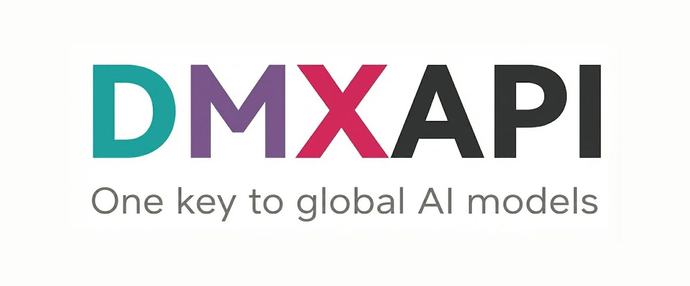</a></td>
<td>Thanks to DMXAPI for sponsoring this project! DMXAPI provides global large model API services to 200+ enterprise users. One API key for all global models. Features include: instant invoicing, unlimited concurrency, starting from $0.15, 24/7 technical support. GPT/Claude/Gemini all at 32% off, domestic models 20-50% off, Claude Code exclusive models at 66% off! <a href="https://www.dmxapi.cn/register?aff=bUHu">Register here</a></td>
</tr>

</table>

</details>

## Why CC Switch?

AI coding tools like Claude Code, Codex, and Gemini CLI each have their own configuration format. Switching API providers means hand-editing JSON, TOML, YAML, or `.env` files, and MCP, Skills, and prompts have to be maintained separately in every tool.

**CC Switch** brings all of this into a single desktop app: pick a preset, enter your key, and switch in one click. Switching replaces only the connection details — endpoint, key, and model — so plugins, hooks, MCP, and comments you added yourself stay as they are.

- **One App, Twelve Tools** — Claude Code, Claude Desktop, Codex, Gemini CLI, Grok Build, OpenCode, OpenClaw, Hermes, Pi, MiniMax Code, Kimi Code, and Oh My Pi
- **No More Manual Editing** — 90+ provider presets including AWS Bedrock, NVIDIA NIM, and community relays
- **Direct, Routing, or Aggregation — Your Choice** — Direct connects the tool straight to the provider; Routing forwards requests through your machine, converting API formats and failing over automatically, so you can use GPT in Claude Code and Claude in Codex; Aggregation puts models from several providers into one model list in Claude Code or Codex, and each request goes to the provider of the model you pick
- **Centralized MCP, Skills & Prompts** — Add MCP servers and Skills once, then choose which tools to sync them to; prompts are maintained separately for each tool
- **Sessions You Can Read** — Turns each tool's session logs into a reading view: what each turn did, which files changed, and which step failed, all at a glance
- **Usage & Quotas at a Glance** — Track token usage and spending even without local routing; remaining subscription quota and account balances show right on provider cards and in the tray
- **Cross-Platform** — Native desktop app for Windows, macOS, and Linux, built with Tauri 2

## Screenshots
>>>>>>> v4.0.20

<table>
<tr>
<th width="50%">官方原版（V4 界面）</th>
<th width="50%">Classic（本仓库）</th>
</tr>
<tr>
<td></td>
<td></td>
</tr>
</table>

- **官方原版**：左侧应用侧栏 + 右侧详情，V4 的新布局，功能入口最多
- **Classic**：完整 V3 布局——顶部应用图标条、通栏卡片列表、`Ctrl+F` 浮动搜索

### ② 设置页

<table>
<tr>
<th width="50%">官方原版（V4 界面）</th>
<th width="50%">Classic（本仓库）</th>
</tr>
<tr>
<td></td>
<td></td>
</tr>
</table>

- **官方原版**：设置项按分组卡片纵向排布，设置分类在左侧栏
- **Classic**：V3 式横向分段页签 + 分段按钮，一屏浏览

### ③ 关于页

<table>
<tr>
<th width="50%">官方原版（V4 界面）</th>
<th width="50%">Classic（本仓库）</th>
</tr>
<tr>
<td></td>
<td></td>
</tr>
</table>

## 怎么选？

| 你想要 | 选它 |
|---|---|
| 原汁原味官方版，第一时间获得上游新功能 | [上游 V4 原版](https://github.com/farion1231/cc-switch/releases) |
| 和 V3 几乎一模一样的手感，内核还是新的 | ✅ **Classic（本仓库）**，[点此下载](https://github.com/jzcangshu/cc-switch-classic/releases/latest) |

## 下载与更新

1. 到 [Releases](https://github.com/jzcangshu/cc-switch-classic/releases/latest) 按平台下载：
   - **Windows x64**: `…-Windows-setup.exe`（安装版）/ `…-Windows-Portable.zip`（绿色版，解压即用）
   - **Windows ARM64**: `…-Windows-arm64-setup.exe` / `…-Windows-arm64-Portable.zip`
   - **Linux x64**: `…-Linux-x86_64.AppImage` / `.deb` / `.rpm`
   - **Linux ARM64**: `…-Linux-arm64.AppImage` / `.deb` / `.rpm`
   - **macOS**（universal，未签名）: `…-macOS-unsigned.dmg`（推荐）或 `…-macOS-unsigned.zip`
2. **macOS 未签名包**首次打开需在「系统设置 → 隐私与安全性」点击「仍要打开」放行；macOS 暂不支持应用内自动更新（Windows/Linux 安装版支持）。
3. 应用内的更新提示**只跟随 Classic 主版本号**（v1.x）；当官方 v4 版发布内核升级后，我们会尽快跟进并推送 Classic 版的更新。

## 与上游的关系

- **内核**：定期合并 [farion1231/cc-switch](https://github.com/farion1231/cc-switch) 的更新（当前内核 v4.0.18），供应商协议、会话管理等能力与上游同步
- **界面**：坚持 V3 经典样式，不随上游改版
- **反馈**：界面与 Classic 相关问题提到[本仓库 issues](https://github.com/jzcangshu/cc-switch-classic/issues)；内核功能问题建议先到[上游 issues](https://github.com/farion1231/cc-switch/issues) 搜索

## 开发

```bash
pnpm install
pnpm tauri dev      # 桌面应用开发模式
pnpm dev:renderer   # 仅前端（浏览器预览）
pnpm test:unit      # 前端单元测试
pnpm tauri build    # 打包
```

<<<<<<< HEAD
=======
Update:

```bash
brew upgrade --cask cc-switch
```

**Method 2: Manual Download**

Download `CC-Switch-v{version}-macOS.dmg` (recommended) or `.zip` from the [Releases](../../releases) page. It's a Universal build that runs natively on both Apple Silicon and Intel Macs.

> **Note**: CC Switch for macOS is code-signed and notarized by Apple. You can install and open it directly.

### Arch Linux Users

**Install via paru (Recommended)**

```bash
paru -S cc-switch-bin
```

### Linux Users

Download the latest Linux build from the [Releases](../../releases) page:

- `CC-Switch-v{version}-Linux-x86_64.deb` / `-Linux-arm64.deb` (Debian/Ubuntu)
- `CC-Switch-v{version}-Linux-x86_64.rpm` / `-Linux-arm64.rpm` (Fedora and other RPM distros that ship WebKitGTK 4.1)
- `CC-Switch-v{version}-Linux-x86_64.AppImage` / `-Linux-arm64.AppImage` (any distro meeting the requirements above)

> **Flatpak**: Not included in official releases. You can build it yourself from the `.deb` — see [`flatpak/README.md`](flatpak/README.md) for instructions.

## Quick Start

### Basic Usage

1. **Add Provider**: Select the tool you want to manage in the sidebar, then click "+" (Add Provider) in the top-right corner of the page → Choose a preset or create a custom configuration
2. **Switch Provider**:
   - Main UI: Select provider → Click "Enable" (for OpenCode, OpenClaw, Hermes, MiniMax Code, and Kimi Code the button is "Add", and for Pi and Oh My Pi it's "Enable" / "Remove"; these seven are coexist-mode tools, so you can add several providers at once)
   - System Tray: One row per tool showing "name · mode · provider · quota"; click a provider name in its submenu to switch (Claude Code, Claude Desktop, Codex, Gemini CLI, and Grok Build)
3. **Takes Effect**: Claude Code needs no restart; for Codex, Gemini CLI, and Grok Build, restart your terminal or the CLI tool; for Claude Desktop, restart the app itself (see FAQ)
4. **Back to Official Login**: Switch to the built-in official provider in the list (e.g. "Claude Official"), restart the tool, then follow its login/OAuth flow
5. **Routing & Aggregation (optional)**: The Claude Code, Codex, Gemini CLI, and Grok Build pages have "Direct" / "Routing" tabs at the top, and Claude Code and Codex also have "Aggregation". Clicking a tab only changes what you're looking at and doesn't touch your configuration; to actually switch, click "Start routing" or "Switch to Aggregation" on the page, and click "Back to direct" to return. Use Routing to use OpenAI- or Gemini-format providers in Claude Code, or Claude in Codex; use Aggregation to mix models from several providers in one model list
6. **Manage Tools**: The "Apps" page in the sidebar shows each AI coding tool's version, install location, and source in one place; you can install, upgrade, or upgrade all, and choose which tools appear in the sidebar

### MCP, Prompts, Skills, Projects & Sessions

- **MCP**: Click "MCP" in the sidebar → Add servers via templates or custom config (or "Import Existing") → Toggle sync for each tool
- **Prompts**: Click "Prompts" in the sidebar → Create prompts with the Markdown editor → Enable one to write it to that tool's prompt file
- **Skills**: Click "Skills" in the sidebar → "Discover Skills" → Search skills.sh or browse GitHub repos → One-click install to supported tools
- **Projects**: First turn on "Show project switcher" in "Settings → General", then on the Claude Code, Claude Desktop, or Codex page, open the project switcher at the top → "New project" to save the current configuration; later, pick it from the switcher to switch the whole setup at once
- **Sessions**: Click "Sessions" in the sidebar → Browse and search conversation history, open the reading view, or restore each tool's sessions
- **Accounts**: Click "Accounts" in the sidebar to sign in to GitHub Copilot, ChatGPT, xAI (Grok), and Kimi Code accounts and use your subscriptions as providers. Kimi Code supports multiple official accounts, each with separate credentials and a native provider; the first login uses Kimi's native default credential slot. Manage sign-in, reauthentication and sign-out here. Official Kimi OAuth nodes still present in the native configuration are protected on the provider page; saved profiles can be deleted after their native nodes are removed.

> **Note**: On first launch, CC Switch automatically imports your existing Claude Code, Codex, Gemini CLI, and Grok Build configuration as a provider named `default` and adds an official provider for each of these tools and Claude Desktop, so nothing you had configured is lost.

For detailed guides on every feature, check out the **[User Manual](docs/user-manual/en/README.md)**, covering provider management, MCP/Prompts/Skills, local routing & failover, and more.

## Features

[Full Changelog](CHANGELOG.md) | [v4.0 Release Notes](docs/release-notes/v4.0.4-en.md)

### Supported Features by Tool

| Tool | Providers | Local Routing | Aggregation | Tray Switching | MCP | Skills | Prompts | Sessions | Usage Stats |
| --- | --- | :---: | :---: | :---: | :---: | :---: | --- | :---: | :---: |
| Claude Code | Switch | ✓ | ✓ | ✓ | ✓ | ✓ | CLAUDE.md | ✓ | ✓ |
| Claude Desktop | Switch | Model Mapping only | – | ✓ | – | – | – | – | Model Mapping only |
| Codex | Switch | ✓ | ✓ | ✓ | ✓ | ✓ | AGENTS.md | ✓ | ✓ |
| Gemini CLI | Switch | ✓ | – | ✓ | ✓ | ✓ | GEMINI.md | ✓ | ✓ |
| Grok Build | Switch | ✓ | – | ✓ | ✓ | ✓ | AGENTS.md | ✓ | ✓ |
| OpenCode | Coexist | – | – | – | ✓ | ✓ | AGENTS.md | ✓ | ✓ |
| OpenClaw | Coexist | – | – | – | – | – | Workspace editor | ✓ | – |
| Hermes | Coexist | – | – | – | ✓ | ✓ | Memory | ✓ | – |
| Pi | Coexist | – | – | – | ✓ | ✓ | AGENTS.md, SYSTEM.md, prompt templates | ✓ | ✓ |
| MiniMax Code | Coexist | – | – | – | ✓ | ✓ | AGENTS.md | ✓ | ✓ |
| Kimi Code | Coexist | – | – | – | ✓ | ✓ | AGENTS.md | ✓ | ✓ |
| Oh My Pi | Coexist | – | – | – | ✓ | ✓ | AGENTS.md | ✓ | – |

- **Switch**: only one provider is active at a time; **Coexist**: multiple providers are written into the tool's own config at the same time, and you pick one inside the tool.
- **Local Routing**: CC Switch forwards requests on your machine and converts API formats; see [Local Routing & Failover](#local-routing--failover) below. Claude Desktop providers can use "Direct" or "Model Mapping"; with "Model Mapping", requests go through local routing.
- **Aggregation**: Puts models from several providers into one model list and sends each request to the provider of the model you pick; see [Aggregation Mode](#aggregation-mode) below.
- **Sessions**: Browse and search conversation history, open the reading view, and copy a resume command to continue a conversation (resuming OpenClaw and Hermes sessions isn't supported yet). Hermes shows only the 500 most recent sessions.
- **Usage Stats**: Without local routing, usage is collected from each tool's local session logs; requests that go through local routing are counted as well.
- The MCP, Skills, Prompts, and Sessions panels opened from the Claude Desktop page apply to Claude Code.

### Provider Management

- **90+ provider presets** — Pick a preset and enter your key to add a provider, or create a custom configuration. The add panel lets you search by name (including Chinese names) and domain, and a vendor's different plans and regions are merged into one row
- **Key fields only** — Switching replaces only the connection details such as the endpoint, key, and model; plugins, hooks, MCP, settings you added yourself, and comments stay as they are. The editor shows what the config file will look like after switching, and CC Switch automatically backs up each config file before rewriting it for the first time
- **Projects** — Save Claude Code's or Codex's current provider, MCP, Skills, and prompt files as a project (for Claude Desktop, only the provider is saved), then switch the whole setup in one click from the project switcher at the top of the page or from the tray; when you switch to another project, the current state is automatically saved back to the previous project. The project switcher is hidden by default; turn on "Show project switcher" in "Settings → General"
- **Accounts (Beta)** — Sign in to multiple GitHub Copilot, ChatGPT, and xAI (Grok) accounts under "Accounts" in the sidebar and use those subscriptions as providers in Claude Code, Claude Desktop, and Codex (everything except Codex's OpenAI Official has to be used in Routing mode). Using a subscription outside the official client may violate the vendor's terms of service; assess the risk yourself
- **Third-party providers for Claude Desktop** — Connect directly to Anthropic-compatible endpoints; for non-Claude models, choose "Model Mapping" to map tiers like Sonnet, Opus, and Haiku to the provider's actual models through local routing
- **Universal providers** — One config syncs to Claude Code, Codex, and Gemini CLI
- One-click switching, system tray quick switching (Claude Code, Claude Desktop, Codex, Gemini CLI, Grok Build), drag-and-drop sorting, import/export

### Local Routing & Failover

- **API format conversion** — Local routing converts requests between Anthropic Messages, OpenAI Chat Completions, OpenAI Responses, and Gemini Native: Claude Code and Claude Desktop can use OpenAI- or Gemini-format providers, and Codex and Grok Build can use Chat Completions or Anthropic Messages providers
- **Per-tool toggle** — Claude Code, Codex, Gemini CLI, and Grok Build can each enter Routing mode separately: click "Start routing" on the "Routing" tab at the top of the page. In Routing mode, switching providers takes effect immediately for subsequent requests (Codex, Gemini CLI, and Grok Build may still need a restart if the switch changes the model). When you quit CC Switch, it writes the direct configuration back first and reconnects the next time it starts
- **Auto-failover** — Configure a failover queue for each tool; when a request fails, CC Switch automatically moves on to the next provider in the queue, backed by a circuit breaker and provider health monitoring
- **Rectifier** — Automatically fixes certain requests that some upstreams can't handle (e.g. Thinking signatures, or falling back when images aren't supported)
- Official providers (e.g. Claude Official) can't go through local routing (except Codex's OpenAI Official)
- The routing service's status, listen address, and failover settings are all in "Settings → Local routing"
- Guides: [Using GPT in Claude Code](docs/guides/claude-codex-routing-guide-en.md) · [Using Claude in Codex](docs/guides/codex-claude-routing-guide-en.md)

### Aggregation Mode

- **One model list, many providers** — On the Claude Code or Codex page, switch to "Aggregation" and add a few providers; their models all appear in the client's model picker. Each request goes to the provider of the model you pick, with no need to switch in CC Switch
- **Add and remove anytime** — Click "Add" or "Remove" on a provider card, then pick one provider as the default; requests that don't name an aggregated model go to it. Codex's OpenAI Official can only be the default provider; Claude official subscriptions are currently unsupported in Aggregation
- **Notes** — Aggregation doesn't provide failover; Claude Code requires version 2.1.243 or later; Codex needs a restart after the aggregated list changes, while Claude Code doesn't. When you switch models within a session, the new model has to rebuild its prompt cache, so the first turn costs a bit more
- Much of Aggregation mode's design draws on [opencodex](https://github.com/lidge-jun/opencodex) — thanks to its author and contributors
- Documentation: [Aggregation mode manual](docs/user-manual/en/4-proxy/4.6-aggregation.md) · [Illustrated guide (Chinese)](docs/guides/aggregation-mode-guide-zh.md)

### MCP, Prompts & Skills

- **Unified MCP panel** — Manage all MCP servers in one place, choose which tools to sync each one to (Claude Code, Codex, Gemini CLI, Grok Build, OpenCode, Hermes, Pi, MiniMax Code, Kimi Code, Oh My Pi), import existing configs from each tool, and import via Deep Link
- **Prompts** — A per-tool prompt library with a Markdown editor; enabling a prompt writes it to that tool's prompt file (CLAUDE.md / AGENTS.md / GEMINI.md), and the file's existing content is saved back to the library first, so nothing is lost. Pi can also edit SYSTEM.md, APPEND_SYSTEM.md, and prompt templates
- **Skills** — Search skills.sh, or install in one click from GitHub repos or ZIP files; check for updates and update all in one click; sync to each tool automatically, via symlinks only, or via copies only; you can optionally store them in `~/.agents/skills`
- All three panels support search, and MCP and Skills can also be enabled or disabled all at once per tool; providers, MCP servers, and prompts are edited full-page in the content area, and you're warned before leaving with unsaved changes

### Usage & Cost Tracking

- **Usage dashboard** — Works without local routing: by default it automatically scans each tool's local session logs and tracks requests, tokens, cache hit rate, output speed, and spending by provider and model, with trend charts, a full-year heatmap, and per-request logs
- **Quotas & balances** — Provider cards and the tray show what's left and the reset countdown, e.g. "5h 94% left": official subscription quotas (Claude, ChatGPT, Gemini, SuperGrok), Coding Plan 5-hour / weekly / monthly quotas (Kimi, Zhipu GLM, MiniMax, Volcengine Ark, etc.), and account balances (DeepSeek, OpenRouter, SiliconFlow, etc.); some need to be turned on first via "Configure usage query" on the provider card, and for other providers you can write a custom usage script. ChatGPT subscriptions also show remaining limit resets and the Codex Credits balance
- **Custom pricing** — Set per-model prices, or import them from models.dev

### Session Manager & Workspace

- **Session reading view** — Parses each tool's session logs into structured content: text, thinking, tool calls, tool results, and images are shown separately; each turn of work collapses into a one-line summary (how many steps, how many files changed, how many failures), with failed steps marked in red; a conversation outline sits on the right, with in-session search, Markdown export, and copying a single turn or the whole conversation
- **List & resume** — Group by project or time, search titles, directories, messages, or session IDs, and delete in bulk; copy a resume command to continue a conversation, and on macOS resume in a terminal with one click
- **Workspace editor** (OpenClaw) — Edit agent files (AGENTS.md, SOUL.md, etc.) and daily memory
- **Memory** (Hermes) — Edit Hermes's MEMORY.md and USER.md

### System & Platform

- **Cloud sync** — Sync across devices via WebDAV (Jianguoyun, Nextcloud, Synology NAS, etc.) or S3-compatible storage (AWS S3, Cloudflare R2, Alibaba Cloud OSS, Tencent Cloud COS, etc.); you can also put the CC Switch configuration directory in a cloud drive folder such as Dropbox, OneDrive, or iCloud
- **CLI tool management** — On the "Apps" page in the sidebar, see the current and latest versions of command-line tools like Claude Code and Codex, install, upgrade, or upgrade all in one click, and diagnose duplicate installations; on Windows it can also manage tools inside WSL (see FAQ)
- **Deep Link** (`ccswitch://`) — Import providers, MCP servers, and prompts, or add skill repositories, in one click via a link; create links with the [online generator](https://ccswitch.io/deplink.html); site owners who want an import button can follow the [integration guide](https://github.com/farion1231/cc-switch/blob/main/docs/guides/deeplink-site-integration-guide-en.md)
- **Built-in utilities** — Skip Claude Code's first-run confirmation, hide AI attribution, have the VS Code Claude Code extension follow CC Switch's provider switches, and more
- Dark / Light / System theme, auto-launch, auto-updater, atomic writes, auto-backups (see where every backup lives and how much space it takes in "Settings → Data"), i18n (zh/zh-TW/en/ja, plus community-translated Turkish)

## FAQ

<details>
<summary><strong>Which AI tools does CC Switch support?</strong></summary>

CC Switch supports twelve tools: **Claude Code**, **Claude Desktop**, **Codex**, **Gemini CLI**, **Grok Build**, **OpenCode**, **OpenClaw**, **Hermes**, **Pi**, **MiniMax Code**, **Kimi Code**, **Oh My Pi**. Each tool has dedicated provider presets and configuration management; see [Supported Features by Tool](#supported-features-by-tool) for what each one supports.

</details>

<details>
<summary><strong>Do I need to restart the terminal after switching providers?</strong></summary>

It depends on the tool:

- **Claude Code**: supports hot-switching of provider data — no restart needed.
- **Codex, Gemini CLI, Grok Build**: restart your terminal or the CLI tool for changes to take effect (CC Switch reminds you after switching). In Routing mode, requests go to the new provider immediately, but all three tools may still need a restart if the switch changes the model.
- **Aggregation mode**: changes to Claude Code's aggregated models take effect immediately; for Codex, entering or leaving Aggregation and changing the aggregated model list all require a full restart — see the next entry.
- **Claude Desktop**: fully quit and reopen Claude Desktop; when using "Model Mapping", also keep CC Switch running.
- **OpenCode, OpenClaw, Hermes, Pi, MiniMax Code, Kimi Code, Oh My Pi**: these are coexist-mode tools — clicking "Add" ("Enable" for Pi and Oh My Pi) writes the provider into the tool's own config alongside the others; you then pick the model you want inside the tool. Kimi Code also provides a "Switch" button to select a provider's model; models still referenced as primary or secondary models cannot be removed. See the [Kimi Code integration guide](docs/kimi-code-integration-zh.md) (Chinese) for configuration and account details.

</details>

<details>
<summary><strong>In Aggregation mode, why don't the aggregated models show up in Codex's /model?</strong></summary>

Codex reads its model list only at startup. After entering or leaving Aggregation mode, adding or removing an aggregated provider, or changing a provider's aggregated models, fully restart Codex to see the new list:

- **Codex CLI**: Closing the terminal and running `codex` again isn't enough. Every `codex` in every terminal shares one background daemon, and it has to be restarted to pick up the new list. When CC Switch detects that Codex is still using the old list, it shows a notice at the top of the Codex page; click "Restart Codex daemon" in the notice. Restarting interrupts any tasks running in the daemon.
- **Codex desktop app**: Quit it completely and reopen it (press ⌘Q on macOS; closing the window isn't enough).
- **Editor extensions**: Reopen the editor window.

Claude Code isn't affected: changes to aggregated models take effect immediately.

</details>

<details>
<summary><strong>Will switching providers change my plugins, hooks, or other settings?</strong></summary>

No. When you switch providers for Claude Code, Codex, Gemini CLI, or Grok Build, CC Switch replaces only the **key fields** in the config file: the endpoint, key, model name, and API protocol (plus the reasoning effort for Codex and the auth method for Gemini CLI), along with a few compatibility options that belong to the provider (such as Claude Code's "Disable Artifact Tool" and the context window). Plugins, hooks, permissions, MCP, environment variables you added yourself, comments, and formatting all stay as they are and apply to every provider.

You can change these shared settings in the tool itself or by editing the config file by hand. You can also edit any provider in CC Switch: the editor shows "what the config file will look like after switching to this provider". When you save, the key fields are stored in that provider, and every other change is written to the config file and applies to every provider.

So the old "Common Config Snippet" is no longer needed, and its buttons have been removed. Settings that were in your snippet before the upgrade were already written into the config file when you switched, so they stay. Before CC Switch rewrites each config file for the first time, it also backs up the original to `~/.cc-switch/backups/live-first-write/`.

</details>

<details>
<summary><strong>I changed the model inside the tool — why does it go back after I switch away and back?</strong></summary>

The model is a key field and belongs to the provider. A model you pick inside the tool (such as with `/model` in Claude Code) stays in effect until the next switch; when you switch, the model in the config file is replaced with the one saved in the target provider, and CC Switch doesn't save the model you picked back to the previous provider. To keep using a model long-term, edit that provider in CC Switch.

Older versions saved the whole config file back to the provider when you switched away. That no longer happens: it froze plugins and other shared settings into one provider, so they were lost when you switched to another one.

</details>

<details>
<summary><strong>Why can't I delete the provider currently in use?</strong></summary>

CC Switch follows a "minimal intrusion" design principle — even if you uninstall the app, your tools will continue to work normally.

So for tools that use one active provider at a time (Claude Code, Claude Desktop, Codex, Gemini CLI, Grok Build), the system always keeps one configuration in use, because deleting all configurations would make the corresponding tool unusable; to delete it, switch to another provider first. Likewise, the default provider in Aggregation mode can't be removed; make another provider the default first. Coexist-mode tools (OpenCode, OpenClaw, Hermes, Pi, and MiniMax Code) aren't subject to this restriction — you can delete any provider directly. If you rarely use a tool, you can hide it from the sidebar on the "Apps" page. To switch back to official login, see the next question.

</details>

<details>
<summary><strong>How do I switch back to official login?</strong></summary>

In CC Switch, the provider lists for Claude Code, Claude Desktop, Codex, Gemini CLI, and Grok Build each include a built-in official provider (**Claude Official**, **Claude Desktop Official**, **OpenAI Official**, **Google Official**, **Grok Official**); if you deleted it, add it back from the presets. After switching to the official provider, follow the tool's own login flow (e.g. `/login` in Claude Code, `codex login` for Codex), and then you can freely switch between the official provider and third-party providers.

For Codex, you can also sign in to multiple ChatGPT accounts inside CC Switch via "Sign in with ChatGPT" and choose an "Account to use" for each **OpenAI Official** card, so switching between multiple Plus, Pro, or Team accounts takes one click; cards set to "Follow Codex login" keep using the Codex CLI's own login.

Note: official subscriptions use the tool's own login and don't go through local routing. Official providers can't be selected in Routing mode (Codex's OpenAI Official cards are the exception); switch back to Direct first.

</details>

<details>
<summary><strong>After I start routing, why does my config file point to 127.0.0.1?</strong></summary>

In Routing mode, the tool's requests first go to CC Switch's local routing (`http://127.0.0.1:15721` by default), and CC Switch then forwards them to the provider you selected. That's why the tool's config file only contains the local address and the placeholder key `PROXY_MANAGED`; for Claude Code, the model name is also written as a fixed alias such as `claude-sonnet-5` (the `/model` menu still shows the real model name). The real provider address, key, and model are all stored in CC Switch. Aggregation mode works the same way.

In the request logs under "Usage" in the sidebar, you can see "requested model → actual model" for each request.

In Routing mode, switching changes the provider that routing uses; the provider you were using before you entered Routing stays the same and is labeled "Direct" on its card. When you click "Back to direct", the config file is written back to this direct provider's configuration. Quitting CC Switch also writes back the direct provider first, and it reconnects the next time CC Switch starts.

</details>

<details>
<summary><strong>Can I use OpenAI-compatible APIs, Gemini, or local models in Claude Code?</strong></summary>

Yes, but you need to use Routing. When editing the provider, set "Upstream Format" under "Advanced Options" to match the provider's API: choose "OpenAI Chat Completions" for services that only offer a Chat Completions endpoint (as many local model servers do), "OpenAI Responses API" for services that offer a Responses endpoint, and "Gemini Native generateContent" for Gemini. Then click "Start routing" on the "Routing" tab of the Claude Code page. Choosing the wrong format or not starting routing usually results in a 404 or 405 error.

Conversely, choosing "Anthropic Messages" as the "Upstream Format" in Codex or Grok Build lets you use Claude-format providers; this also requires Routing. See [Using GPT in Claude Code](docs/guides/claude-codex-routing-guide-en.md) and [Using Claude in Codex](docs/guides/codex-claude-routing-guide-en.md) for details.

</details>

<details>
<summary><strong>"Connectivity check" passed, so why do requests still fail?</strong></summary>

The "Connectivity check" on a provider card only checks whether the provider address is reachable; it doesn't send a real model request, so it can't verify whether the API key and model name are correct. When requests fail, check the key, model name, and upstream format; for requests that go through Routing, you can also see the exact error in the request logs under "Usage" in the sidebar.

</details>

<details>
<summary><strong>Where is my data stored?</strong></summary>

By default, everything is stored in the `.cc-switch` folder in your home directory (`C:\Users\<user>\.cc-switch` on Windows):

- **Database**: `cc-switch.db` (SQLite — providers, MCP, prompts, Skills, projects, usage records, etc.)
- **Local settings**: `settings.json` (device-level settings such as each tool's config directory, backup policy, and cloud sync connection details)
- **Backups**: `backups/` (backed up automatically every 24 hours by default, keeping the 10 most recent; adjustable in "Settings → Data → Backup & Restore"; "Other Backups" below it lists the location and size of every other backup, which you can clean up by category)
- **Skills**: `skills/` (can be changed to `~/.agents/skills` in Settings), synced to each tool via symlinks by default, falling back to copying if that fails
- **Skill Backups**: `skill-backups/` (created automatically before uninstalling or updating a skill, keeping the 20 most recent)
- **OAuth login credentials**: `copilot_auth.json`, `codex_oauth_auth.json`, `xai_oauth_auth.json`
- **Logs**: `logs/cc-switch.log` and `crash.log` — please attach them when reporting an issue
- **Device state**: `live-state.json` (whether each tool is currently in Direct, Routing, or Aggregation mode, and what was last written), `codex-login-stash.json` (the official Codex login moved aside when you switch to a third-party provider, restored when you switch back to an official one)
- **Original config files**: `backups/live-first-write/` (each tool's config file as it was before CC Switch first rewrote it)

After you change "CC Switch Configuration Directory" in "Settings → Data → Location", all of the files above except `settings.json`, the device state, and the original config files are stored in the new directory. CC Switch doesn't move existing files automatically, so copy them over manually first. `settings.json`, the device state, and the original config files belong to this computer only: they always stay in the default directory and are not included in cloud sync.

</details>

<details>
<summary><strong>How do I manage tools inside WSL on Windows?</strong></summary>

CC Switch doesn't detect WSL automatically. In "Settings → App config", change the config directory for the corresponding tool to a path inside WSL, e.g. `\\wsl.localhost\Ubuntu\home\<user>\.claude`; after you save, CC Switch reads and writes the config inside WSL (supported for Claude Code, Codex, Gemini CLI, Grok Build, OpenCode, OpenClaw, Hermes, and Pi). Once this is set, the "Apps" page in the sidebar also detects and upgrades that tool in the corresponding WSL distribution.

Note: Routing and Aggregation write `127.0.0.1` as the address into the config. In WSL2's default NAT networking mode, `127.0.0.1` inside WSL can't reach local routing on Windows; switch WSL to mirrored networking mode instead.

</details>

<details>
<summary><strong>Is there a command-line or headless version?</strong></summary>

CC Switch itself only ships as a desktop app that requires a graphical interface (see [Download & Installation](#download--installation) for system requirements). For servers, SSH sessions, or machines without a desktop environment, we recommend the community-maintained **[CC Switch CLI](https://github.com/SaladDay/cc-switch-cli)**: it offers both an interactive terminal UI (TUI) and a command-line mode, supports Claude Code, Codex, Gemini CLI, OpenCode, OpenClaw, Hermes, and Pi, and can be installed via Homebrew (`brew install cc-switch-cli`) or an install script.

By default, CC Switch CLI shares the `~/.cc-switch` data directory with the desktop app and is compatible with the desktop app's WebDAV sync. The two projects are released separately, and the database version the CLI supports sometimes lags behind the desktop app; if you see a "database version is too new" message, upgrade the CLI or wait for it to catch up.

</details>

<details>
<summary><strong>Linux (Wayland + NVIDIA): clicks don't register and the window black-screens on resize</strong></summary>

The AppImage forces `GDK_BACKEND=x11` (XWayland) to avoid a historical native-Wayland crash. On newer Wayland + NVIDIA setups this can leave the web content area unclickable (the title-bar buttons still work) and black-screen on resize. Launch with the opt-in escape hatch to switch back to native Wayland:

```bash
CC_SWITCH_GDK_BACKEND=wayland ./CC-Switch-*.AppImage
```

If you launch from a desktop icon, add it to the `.desktop` `Exec=` line (e.g. `env CC_SWITCH_GDK_BACKEND=wayland /path/to/AppImage`) or set it in your session environment. The variable is generic: on tiling Wayland compositors (sway/Hyprland) where clicks don't register, try `CC_SWITCH_GDK_BACKEND=x11` instead. Leaving it unset keeps the default behavior.

</details>

For more questions, see the [FAQ](docs/user-manual/en/5-faq/5.2-questions.md) in the User Manual.

## Contributing

Issues and suggestions are welcome! Before developing a new feature, please open an issue to discuss the approach first; feature PRs that aren't a good fit for the project may be closed.

For development setup, pre-submit checks, and architecture notes, see [CONTRIBUTING.md](CONTRIBUTING.md); for usage questions, check [SUPPORT.md](SUPPORT.md) first; report security vulnerabilities privately as described in [SECURITY.md](SECURITY.md).

**Tech stack**: Tauri 2 · Rust · React 18 · TypeScript · SQLite

## Star History

[](https://www.star-history.com/#farion1231/cc-switch&Date)

>>>>>>> v4.0.20
## License

本项目基于 [farion1231/cc-switch](https://github.com/farion1231/cc-switch)（MIT License, © Jason Young）二次开发，沿用 MIT 协议开源。感谢上游作者与社区。


## 🔗 LinuxDo 社区

<div align="center">
  <a href="https://linux.do" target="_blank">
    
  </a>
  <p>
    <a href="https://linux.do" target="_blank"><strong>LinuxDo 社区</strong></a><br>
  </p>
    <p>@蕉灼の仓鼠</p>
    <p>本人长期活跃于L站;</p>
    <p>这里的人很好说话又好听;</p>
    <p>欢迎都来加入L站大家庭。 </p>

