<div align="center">


# CC Switch Classic

**V3 经典界面 × V4 现代内核**

*Classic V3-style UI on the cc-switch V4 core.*

[](https://github.com/jzcangshu/cc-switch-classic/releases)
[](https://github.com/farion1231/cc-switch)
[](#license)
[-9cf)](#下载与更新)

[下载最新版](https://github.com/jzcangshu/cc-switch-classic/releases/latest) · [更新日志](https://github.com/jzcangshu/cc-switch-classic/releases) · [上游项目](https://github.com/farion1231/cc-switch)

</div>

<<<<<<< HEAD
=======
## ❤️Sponsor

> [Want to appear here?](mailto:support@ccswitch.io)

<details open>
<summary>Click to collapse</summary>

[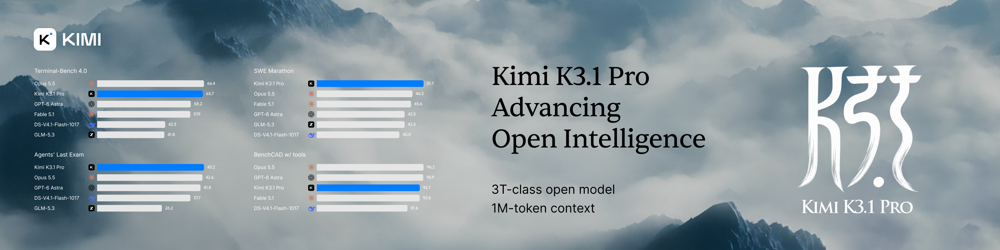](https://platform.kimi.ai?track_id=track-674ed6e2af924a5682a87421f7cf753a&aff=cc-switch)

Kimi K3.1 Pro is Moonshot AI's most capable 3T-class open-weight model to date, with a 1-million-token context window. Built on Kimi K3 with substantially larger post-training compute, it delivers consistent gains across coding, agentic workflows, 3D creation, and reasoning. CC Switch makes it easy to configure and switch to Kimi K3.1 Pro across agentic tools.

Try a **Kimi Code plan** ([中文站](https://www.kimi.com/code?aff=cc-switch) | [Global](https://www.kimi.ai/code?aff=cc-switch)), or use the **API** through the Kimi Open Platform ([中文站](https://platform.kimi.com?track_id=track-7cf2b91dcde043eda6ef9a95951a042c&aff=cc-switch) | [Global](https://platform.kimi.ai?track_id=track-674ed6e2af924a5682a87421f7cf753a&aff=cc-switch)).

**New user top-up bonus**: register and complete your first top-up via the API links above to receive 10% of the amount as bonus API credit, up to CNY ¥1,000.

>>>>>>> v4.0.25
---

## 这是什么

[CC Switch](https://github.com/farion1231/cc-switch) 是一款管理 Claude Code / Codex 等 AI 编程工具供应商配置的桌面应用。官方 **V4 版**把界面全面改版成了侧栏布局。

**CC Switch Classic** 在**完全相同的 V4 内核**之上，把界面换回 V3 的经典样式——功能不缺，手感照旧。

<<<<<<< HEAD
两套界面长什么样、有什么区别，往下看图对比，挑一个顺手的用。
=======
<tr>
<td width="180"><a href="https://pateway.ai/?ch=etzpm8&aff=WB6M6F67#/">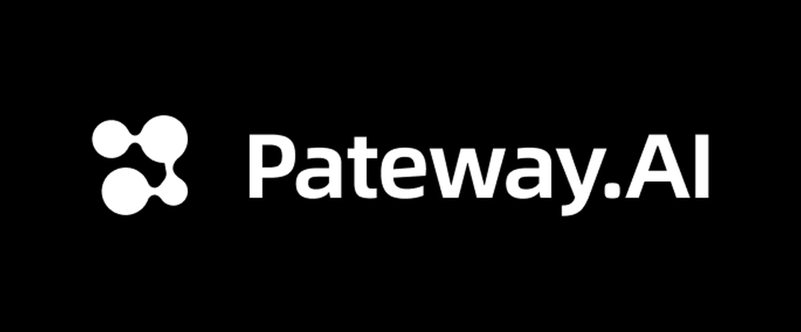</a></td>
<td>Thanks to PatewayAI for sponsoring this project! PatewayAI is an API relay service provider for experienced AI developers, with full support for Claude, the GPT series, and a wide range of mainstream Chinese models. All models come from official high-quality channels — never diluted, never faked — with transparent, verifiable billing details.
The economy mode goes as low as 5% of the original price. Register via <a href="https://pateway.ai/?ch=etzpm8&aff=WB6M6F67#/">this link</a> to get a free $1 trial credit, and join occasional promotions for more free credit.
The platform also supports enterprise-grade concurrency, a dedicated admin console, formal contracts and invoices, and offers a two-way referral top-up bonus of up to $150.</td>
</tr>
>>>>>>> v4.0.25

## 界面对比

以下截图均为真实程序界面，两个版本使用同一份数据，方便横向对比。

<<<<<<< HEAD
### ① 供应商首页
=======
<tr>
<td width="180"><a href="https://runapi.host/register?aff=iOKB">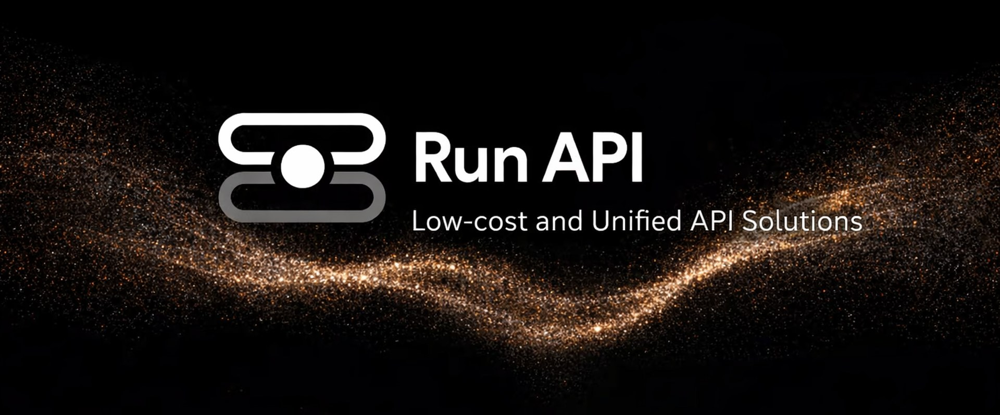</a></td>
<td>Thanks to RunAPI for sponsoring this project! RunAPI is a high-performance and reliable AI model API gateway — one API key gives you access to 150+ mainstream models including OpenAI, Claude, Gemini, DeepSeek, and Grok, with prices as low as 10% of the official rate and excellent stability. It works seamlessly with Claude Code, OpenClaw, and other tools. Exclusive benefit for CC Switch users: register via <a href="https://runapi.host/register?aff=iOKB">this link</a> and enjoy a 10% discount on your first top-up!</td>
</tr>

<tr>
<td width="180"><a href="https://www.openmodel.ai?ref=cc-switch"></a></td>
<td>Thanks to OpenModel for sponsoring this project! OpenModel offers client-specific discounts of up to 90% for Codex and 60% for Claude Code across supported models, helping developers cut API costs without changing how they work. Just connect your OpenModel API key and keep using Codex or Claude Code as usual — supported clients are detected automatically and discounted routes are applied with no extra parameters or manual routing required. You can also configure fallback behavior per API key, choosing whether to continue at standard pricing or stop when a discounted route is temporarily unavailable. CC Switch users can register via <a href="https://www.openmodel.ai?ref=cc-switch">this link</a> and use promo code <strong>"cc-switch"</strong> to get 10% off their first top-up.</td>
</tr>

<tr>
<td width="180"><a href="https://grooroute.pro/sign-up?aff=qqm9"></a></td>
<td>Thanks to GrooRoute Pro for sponsoring this project! GrooRoute Pro is a reliable, smooth AI API relay platform with access to OpenAI, Claude, DeepSeek, and other mainstream models. Deployed on overseas servers, it lets you choose your own pricing-multiplier tier and offers both pay-as-you-go billing and subscription plans, so you can use it however suits you best — with stable routes and fast responses that make calling all kinds of AI capabilities easier. Exclusive benefit for CC Switch users: register via <a href="https://grooroute.pro/sign-up?aff=qqm9">this link</a> to get ¥5 in free trial credit!</td>
</tr>

<tr>
<td width="180"><a href="https://buytoken.work/sign-up?aff=cc-switch"></a></td>
<td>Thanks to BuyToken for sponsoring this project! BuyToken offers relay services for Claude Code, Codex, DeepSeek, and more, with enterprise-grade concurrency and fast invoicing — built to be a stable, long-running service. BuyToken also offers CC Switch users a special deal: register via <a href="https://buytoken.work/sign-up?aff=cc-switch">this link</a> to get ¥3 in trial credit, plus 10% off your first top-up!</td>
</tr>

<tr>
<td width="180"><a href="https://gpt.ge/signup?aff=URNP">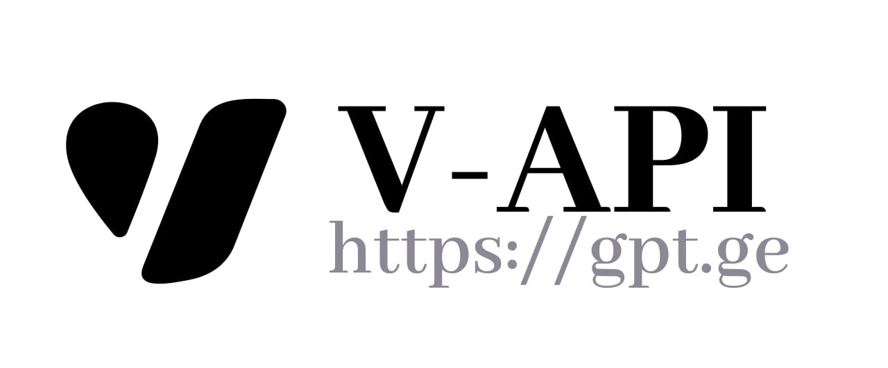</a></td>
<td>Thanks to V-API for sponsoring this project! V-API is a three-year-old brand dedicated to providing individuals, developers, and businesses with a stable, fast, and secure platform for high-quality LLM API services, with support for formal contracts and official invoices (general / special VAT). V-API offers CC Switch users a special deal: register via <a href="https://gpt.ge/signup?aff=URNP">this link</a> to get ¥2 off plus 10% off your first order!</td>
</tr>

<tr>
<td width="180"><a href="https://agentmarket.fluxapay.xyz/marketplace/tokenplans"></a></td>
<td>Thanks to FluxA &amp; Baidu AI Cloud for sponsoring this project! FluxA and Baidu AI Cloud jointly launched AgenticPlan, which gives AI agents the ability to buy, manage and use models, APIs and tools on their own. It includes Baidu Qianfan TokenPlan at up to 40% off, with access to flagship models such as DeepSeek V4, GLM 5.2 and Kimi, plus bonus FluxA AgentMarket API credits that unlock 13,000+ paid APIs for search, data scraping, social media, finance, crypto, image generation, video and more.<br>With the user's authorization, an AI agent can also pay with the official Visa card to procure resources on its own, manage API keys, monitor usage and plan renewals — taking agents from "completing tasks autonomously" to genuinely "planning their own budget and completing tasks". Buy via <a href="https://agentmarket.fluxapay.xyz/marketplace/tokenplans">this link</a>!</td>
</tr>

<tr>
<td width="180"><a href="https://aigocode.net/invite/CC-SWITCH"><picture><source media="(prefers-color-scheme: dark)" srcset="assets/partners/logos/aigocode-dark.png">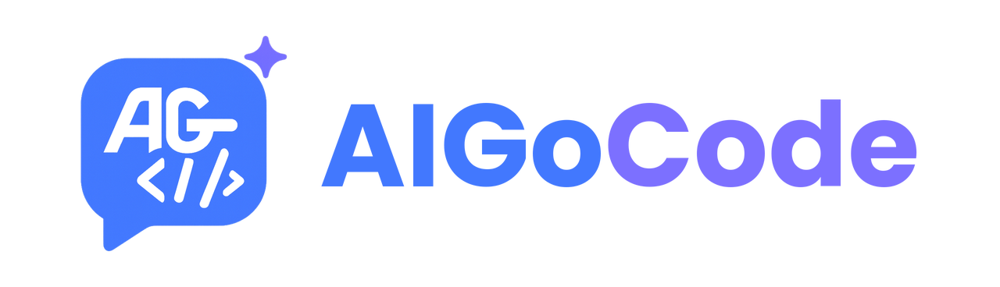</picture></a></td>
<td>Thanks to AIGoCode for sponsoring this project! AIGoCode is a subscription-based AI coding platform, not just pay-per-token. One account, one monthly plan for Claude Code, Codex and Gemini, with direct connection on the mainland and fast responses. Subscribe via <a href="https://aigocode.net/invite/CC-SWITCH">this link</a> to get an extra 10% credits!</td>
</tr>

<tr>
<td width="180"><a href="https://teamorouter.cn/?utm_source=cc_switch&utm_medium=referral&utm_campaign=ai_directory"></a></td>
<td>Thanks to TeamoRouter for sponsoring this project! TeamoRouter is an enterprise-grade Agentic LLM gateway built for developers, AI teams, and businesses. Without requiring any subscriptions, it lets you access Claude Code, Codex, Gemini CLI, OpenAI Codex, and other popular AI agents through a single unified API, while offering API pricing at discounts of up to 90%.
Unlike typical API relay services, TeamoRouter aggregates hundreds of official model providers and trusted infrastructure partners, including OpenAI, Anthropic, Vertex, Azure, and AWS bedrock. Every provider is verified for 100% Agent protocol compatibility, cache performance, and request traceability, ensuring stable quality instead of reverse-engineered or diluted endpoints. The platform delivers near-official TTFT, 99.6% SLA, enterprise-scale throughput up to 5,000 QPM, and industry-leading cache hit rates that dramatically reduce token costs for long-running agent workflows.
TeamoRouter also offers enterprise features including centralized billing, team management, BYOK, smart routing, usage analytics, dynamic provider optimization, and dedicated support. For an even simpler experience, Teamo Desktop lets you use Claude Code, Codex, Gemini CLI, and other popular AI agents with one-click setup—no API key management or manual gateway configuration required. Register via <a href="https://teamorouter.cn/?utm_source=cc_switch&utm_medium=referral&utm_campaign=ai_directory">this link</a> as a new user to receive 10% off your first top-up.</td>
</tr>

<tr>
<td width="180"><a href="https://aicoding.inc/i/CCSWITCH">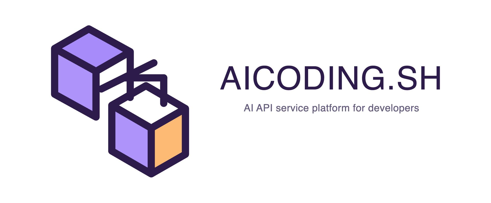</a></td>
<td>Thanks to AICoding for sponsoring this project! AICoding — Global AI Model API Relay Service at Unbeatable Prices! Claude Code at 19% of original price, GPT at just 1%! Trusted by hundreds of enterprises for cost-effective AI services. Supports Claude Code, GPT, Gemini and major domestic models, with enterprise-grade high concurrency, fast invoicing, and 24/7 dedicated technical support. CC Switch users who register via <a href="https://aicoding.inc/i/CCSWITCH">this link</a> get 10% off their first top-up!</td>
</tr>

<tr>
<td width="180"><a href="https://subrouter.ai/register?aff=l3ri"></a></td>
<td>Thanks to SubRouter for sponsoring this project! SubRouter is a marketplace and smart routing platform for AI service operators. Merchants can launch operating sites, publish packages, manage users, models, and pricing, while users discover services and access reliable AI models through one unified API. Register via <a href="https://subrouter.ai/register?aff=l3ri">this link</a>!</td>
</tr>

<tr>
<td width="180"><a href="https://open.ospreyai.cn"></a></td>
<td>Thanks to OspreyAI for sponsoring this project! ACS OspreyAI is a one-stop multi-model API platform for developers and businesses. A single API key gives you access to leading Chinese and international models, including Claude, Gemini, GPT, GLM, Kimi, Qwen, DeepSeek, and Tencent Hunyuan. The platform is compatible with OpenAI, Anthropic, and other mainstream API protocols, and works with popular AI tools such as Claude Code, Codex, OpenCode, Pi, and Hermes. International models cost 20–40% less than official prices, and Chinese models 30–50% less. Unified top-ups, unified billing, usage tracking, and flexible model switching make it a fit for AI app development, content production, and automated workflows. Create an account via <a href="https://open.ospreyai.cn">this link</a> to get a discount and quickly connect to leading models from China and abroad.</td>
</tr>

<tr>
<td width="180"><a href="https://www.shengsuanyun.com/?from=CH_4HHXMRYF"></a></td>
<td>Thanks to Shengsuanyun for sponsoring this project! Shengsuanyun is a super factory serving AI Native Teams — an industrial-grade AI task parallel execution platform. Its model marketplace aggregates Claude, ChatGPT, Gemini, and other domestic and international LLM and multimedia model capabilities with direct supply. Absolutely no reverse engineering or dilution — platform-wide model SLA availability reaches 99.7%, with <a href="https://watch.shengsuanyun.com/status/shengsuanyun">monitoring dashboards</a> showing green across the board. It also offers enterprise-grade custom gateways for fine-grained team cost and permission management, smart routing, security protection, and BYOK (Bring Your Own Key) hosting. The platform charges on a pay-per-use and tokens plan (coming soon) basis, with invoicing available. Register via <a href="https://www.shengsuanyun.com/?from=CH_4HHXMRYF">this link</a> as a new user to receive ¥10 in credits plus a 10% bonus on your first top-up.</td>
</tr>

<tr>
<td width="180"><a href="https://88api.ai/sign-up?aff=HSGY"></a></td>
<td>Thanks to 88API Token Aggregation Platform for sponsoring this project! 88API is a one-stop multi-model API platform operated by a Hong Kong company, built mainly for developers, creators and AI application users. A unified interface gives access to text, image, speech and video models, covering common workflows such as AI coding, smart translation, content creation, voice-over, image generation and video generation. You can add it as a provider and switch to it right inside CC Switch. 88API supports major international payment methods, can issue invoices, and provides enterprise-grade stable service. Register via <a href="https://88api.ai/sign-up?aff=HSGY">this link</a> to receive exclusive bonus credits!</td>
</tr>

<tr>
<td width="180"><a href="https://apikey.fan/register?aff=CCSwitch"></a></td>
<td>Thanks to APIKEY.FUN for sponsoring this project! APIKEY.FUN is a professional enterprise-grade AI relay platform dedicated to providing stable, efficient, and low-cost AI model API access for enterprises and individual developers. The platform supports popular mainstream models such as Claude, OpenAI, and Gemini, with prices as low as 7% of official rates. Register through this project's <a href="https://apikey.fan/register?aff=CCSwitch">exclusive link</a> to enjoy an exclusive offer of up to <strong>permanent 5% off top-ups</strong>.</td>
</tr>

<tr>
<td width="180"><a href="https://9527.codes/register?aff=e5zI">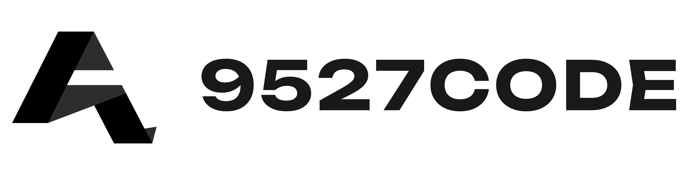</a></td>
<td>Thanks to 9527CODE for sponsoring this project! 9527 CODE is an enterprise-grade, full-capability AI relay platform focused on stability and service quality, providing fast, stable, and high-quality relay services for Claude Code, Codex, and other mainstream AI models. It places greater emphasis on long-term stability, route quality, and sustained availability, offering enterprises and heavy AI users a stable and efficient one-stop model access solution. With one year of continuous operation, 99.9% service stability, and 7×24 human technical support. Register through this project's <a href="https://9527.codes/register?aff=e5zI">exclusive link</a>; new users can contact customer service to receive trial credit, and referral cashback is unlimited!</td>
</tr>

<tr>
<td width="180"><a href="https://ppio.com/activity/ccswitch"></a></td>
<td>Thanks to PPIO for sponsoring this project! PPIO is a leading independent Agentic Cloud provider in China, co-founded in 2018 by PPTV founder Yao Xin and former PPTV chief architect Wang Wenyu. A single API key gives you access to every flagship open-source model, including DeepSeek-V4-Flash, Kimi-K3, GLM-5.2, and MiniMax-M3; the enterprise Token Plan is available at up to 40% off and supports 200 seats, and the Fusion blended model matches Fable5 at one-tenth of the price. Register via <a href="https://ppio.com/activity/ccswitch">this link</a> and complete identity verification to receive a ¥10 credit voucher — invite friends to top up and earn up to 15% cashback on their spend.</td>
</tr>

<tr>
<td width="180"><a href="https://www.newapi.ai/"></a></td>
<td>Thanks to the open-source AI infrastructure project <a href="https://www.newapi.ai/">new-api</a> for its strong support of this project! new-api is an open-source AI infrastructure project from QuantumNous and one of the leading unified LLM access-and-distribution projects by activity and adoption, focused on helping developers, teams, and enterprises build manageable, scalable AI service platforms at lower cost. As a fellow project rooted in the open-source ecosystem, new-api hopes to sponsor and support the continued growth of more outstanding open-source projects. 🌟 Star new-api to show your support: <a href="https://github.com/QuantumNous/new-api">https://github.com/QuantumNous/new-api</a>. Website: <a href="https://www.newapi.ai/">https://www.newapi.ai/</a>.</td>
</tr>

<tr>
<td width="180"><a href="https://claudecn.ai/register?aff=HEL9">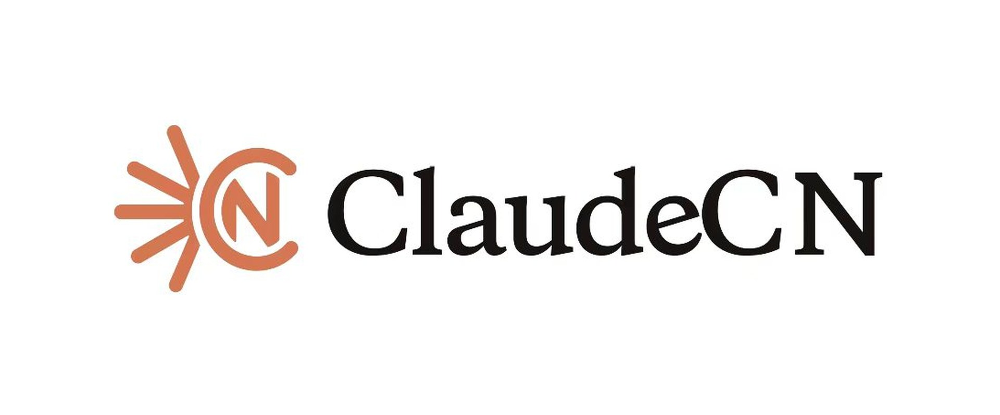</a></td>
<td>Thanks to ClaudeCN for sponsoring this project! ClaudeCN is an enterprise-grade AI gateway platform operated by a registered company. It delivers high-availability commercial API access to popular models including Claude, GPT, and DeepSeek, and is built around formal enterprise procurement workflows — corporate bank transfers, signed contracts, and full compliance. Register via <a href="https://claudecn.ai/register?aff=HEL9">this link</a>!</td>
</tr>

<tr>
<td width="180"><a href="https://www.byteplus.com/en/product/modelark?utm_campaign=hw&utm_content=ccswitch&utm_medium=devrel_tool_web&utm_source=OWO&utm_term=ccswitch">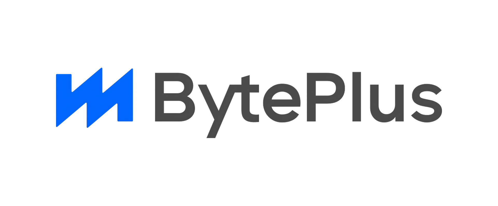</a></td>
<td>Thanks to Dola seed for sponsoring this project! Dola Seed 2.0 is a full‑modal general large model independently developed by ByteDance for the global market. Built on a unified multimodal architecture, it supports joint understanding and generation of text, images, audio, and video. It natively enables agent collaboration, with strong reasoning, long‑task execution, tool integration, and coding capabilities. It is widely applicable to smart cockpits, personal assistants, education, customer support, marketing, retail, and other scenarios. It excels in multimodal perception, end‑to‑end complex task delivery, stable interaction, and data security, and is readily accessible and deployable via the ModelArk platform. Register via <a href="https://www.byteplus.com/en/product/modelark?utm_campaign=hw&utm_content=ccswitch&utm_medium=devrel_tool_web&utm_source=OWO&utm_term=ccswitch">this link</a> to get 500,000 tokens of free inference quota per model.<a href="https://www.volcengine.com/activity/ai618?utm_campaign=hw&utm_content=hw&utm_medium=devrel_tool_web&utm_source=OWO&utm_term=ccswitch"> >>中国大陆地区的开发者请点击这里</a></td>
</tr>

<tr>
<td width="180"><a href="https://cloud.siliconflow.cn/i/YflgU2Ve">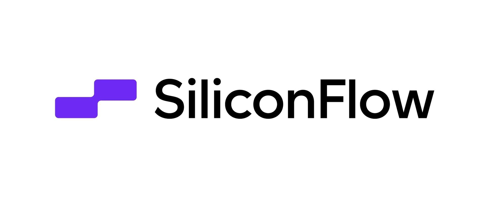</a></td>
<td>Thanks to SiliconFlow for sponsoring this project! SiliconFlow is a high-performance AI infrastructure and model API platform, providing fast and reliable access to language, speech, image, and video models in one place. With pay-as-you-go billing, broad multimodal model support, high-speed inference, and enterprise-grade stability, SiliconFlow helps developers and teams build and scale AI applications more efficiently. Register via <a href="https://cloud.siliconflow.cn/i/YflgU2Ve">this link</a> and complete real-name verification to receive ¥16 in bonus credit, usable across models on the platform. SiliconFlow is also now compatible with OpenClaw, allowing users to connect a SiliconFlow API key and call major AI models for free.</td>
</tr>

<tr>
<td width="180"><a href="https://a6api.vip/register?aff=AqNr"></a></td>
<td>Thanks to <a href="https://a6api.vip/register?aff=AqNr">A6API</a> for sponsoring this project! A6API is a one-stop AI model API aggregation platform covering Claude, GPT, Gemini, Codex, and other mainstream models. Multiple vendors can list their supply on the platform, so the same model can be quoted competitively by several upstream providers. Smart routing automatically picks the more stable, lower-priced route available and fails over automatically, helping you reduce failed requests, cut costs, and improve stability. Whether you are an individual developer, an AI product team, or a studio, you can integrate quickly through a unified interface — compatible with all formats, with low migration cost. New users who register via <a href="https://a6api.vip/register?aff=AqNr">this link</a> receive free trial credits: try it first, then use it at a low price.</td>
</tr>

<tr>
<td width="180"><a href="https://www.compshare.cn/coding-plan?ytag=GPU_YY_YX_git_cc-switch"></a></td>
<td>Thanks to Compshare for sponsoring this project! Compshare is UCloud's AI cloud platform, providing stable and comprehensive domestic and international model APIs with just one key. Featuring cost-effective monthly and per-use domestic-model Coding Plan packages, alongside stable officially-relayed overseas models. Supports Claude Code, Codex, and API access. Enterprise-grade high concurrency, 24/7 technical support, and self-service invoicing. Users who register via <a href="https://www.compshare.cn/coding-plan?ytag=GPU_YY_YX_git_cc-switch">this link</a> will receive a free 5 CNY platform trial credit!</td>
</tr>

<tr>
<td width="180"><a href="https://www.ccsub.net/register?ref=Y6Z8DXEA"></a></td>
<td>Thanks to CCSub for sponsoring this project! CCSub is a stable, affordable AI API relay platform — your drop-in replacement for a Claude.ai subscription. One API key gives you access to Claude Opus 4.8, Sonnet, Haiku, GPT-5, Gemini, and DeepSeek at roughly 30% of direct API cost, with no VPN required from anywhere in the world. Compatible with Claude Code, Codex, Cursor, Cline, Continue, Windsurf, and all major AI coding tools. Register via <a href="https://www.ccsub.net/register?ref=Y6Z8DXEA">this link</a> and get $5 free credit on sign-up.</td>
</tr>

<tr>
<td width="180"><a href="https://sssaicodeapi.com/register?ref=DCP0SM">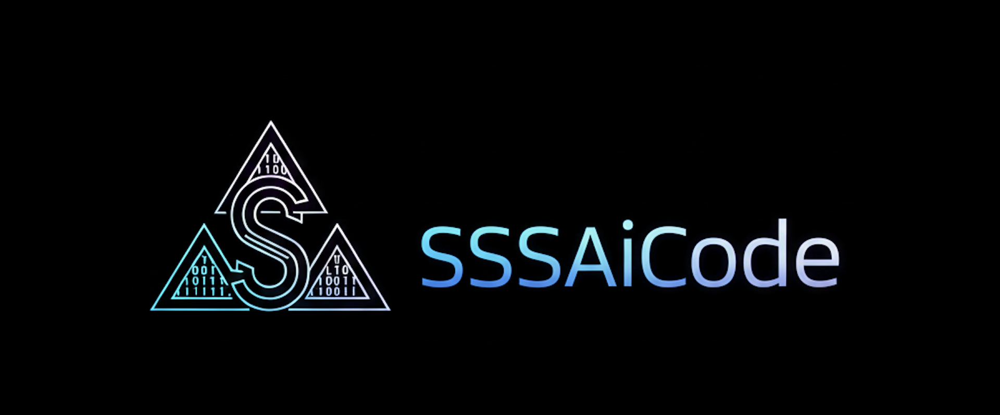</a></td>
<td>Thanks to SSSAiCode for sponsoring this project! SSSAiCode is a stable and reliable API relay service, dedicated to providing stable, reliable, and affordable Claude and Codex model services, with same-day fast invoicing. SSSAiCode offers a special deal for CC Switch users: register via <a href="https://sssaicodeapi.com/register?ref=DCP0SM">this link</a> to enjoy $10 extra credit on every top-up!</td>
</tr>

<tr>
<td width="180"><a href="https://soleapi.com/r/ccswitch">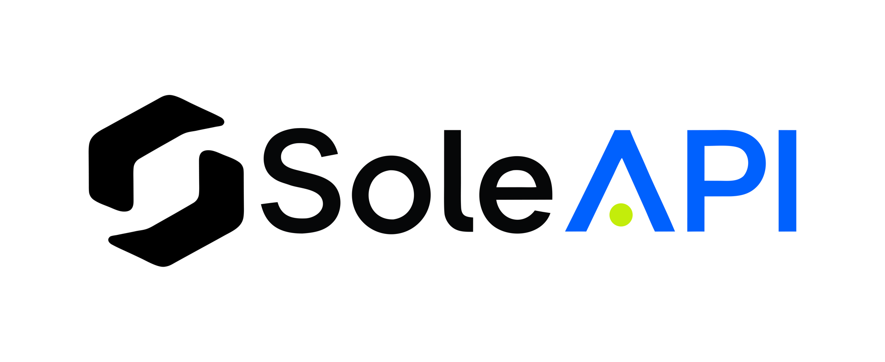</a></td>
<td>Thanks to SoleAPI for supporting this project! SoleAPI is an AI model gateway for developers and enterprises: one API key gives you access to 30+ leading models including Claude, GPT and Gemini. It is natively compatible with the OpenAI and Anthropic protocols, so Claude Code, Codex, Cursor and your existing SDKs work by simply changing the Base URL. Requests are routed in real time by latency and upstream health, with millisecond-level automatic failover to backup channels, 99.99% service availability and 24/7 technical support. Every call lands on a single bill with per-request token and cost breakdowns you can inspect at any time. Sign up through this project's <a href="https://soleapi.com/r/ccswitch">referral link</a> to receive free trial credits, and earn ongoing cashback by inviting friends who top up!</td>
</tr>

<tr>
<td width="180"><a href="https://www.micuapi.ai/register?aff=aOYQ"></a></td>
<td>Thanks to Micu API for sponsoring this project! Micu API is a global LLM relay service provider dedicated to delivering the best cost-performance ratio with high stability. Backed by a registered enterprise for core assurance, eliminating any risk of service discontinuation, with fast official invoicing support! We champion "zero cost to try": top up from as low as ¥1 with no minimum, and get fee-free refunds anytime! Micu API offers an exclusive deal for CC Switch users: register via <a href="https://www.micuapi.ai/register?aff=aOYQ">this link</a> and enter promo code "ccswitch" when topping up to enjoy a <strong>10% discount</strong>!</td>
</tr>

<tr>
<td width="180"><a href="https://www.rightapi.ai/register?aff=CCSWITCH">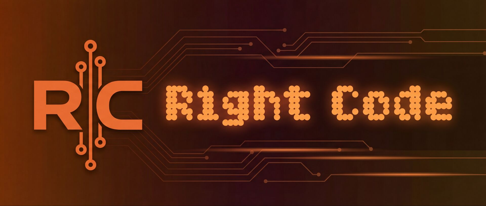</a></td>
<td>Thank you to Right Code for sponsoring this project! Right Code reliably provides routing services for models such as Claude Code, Codex, and Gemini, with both pay-as-you-go and monthly subscription billing options available. Invoices are available upon top-up, and enterprise and team users can receive dedicated one-on-one support. Right Code also offers an exclusive discount for CC Switch users: register via <a href="https://www.rightapi.ai/register?aff=CCSWITCH">this link</a>, and with every top-up you will receive pay-as-you-go credit equivalent to 5% of the amount paid.</td>
</tr>

<tr>
<td width="180"><a href="https://cubence.com/signup?code=CCSWITCH&source=ccs"></a></td>
<td>Thanks to Cubence for sponsoring this project! Cubence is a reliable and efficient API relay service provider, offering relay services for Claude Code, Codex, Gemini, and more with flexible billing options including pay-as-you-go and monthly plans. Cubence provides special discounts for CC Switch users: register using <a href="https://cubence.com/signup?code=CCSWITCH&source=ccs">this link</a> and enter the "CCSWITCH" promo code during recharge to get 10% off every top-up!</td>
</tr>

<tr>
<td width="180"><a href="https://crazyrouter.com/register?aff=OZcm&ref=cc-switch">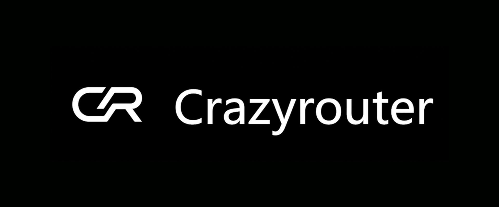</a></td>
<td>Thanks to Crazyrouter for sponsoring this project! Crazyrouter is a high-performance AI API aggregation platform — one API key for 300+ models including Claude Code, Codex, Gemini CLI, and more. All models at 55% of official pricing with auto-failover, smart routing, and unlimited concurrency. Crazyrouter offers an exclusive deal for CC Switch users: register via <a href="https://crazyrouter.com/register?aff=OZcm&ref=cc-switch">this link</a> and contact customer support to claim <strong>$2 free credit</strong>, plus enter promo code `CCSWITCH` on your first top-up for an extra <strong>30% bonus credit</strong>! </td>
</tr>

<tr>
<td width="180"><a href="https://www.dmxapi.cn/register?aff=bUHu"></a></td>
<td>Thanks to DMXAPI for sponsoring this project! DMXAPI provides global large model API services to 200+ enterprise users. One API key for all global models. Features include: instant invoicing, unlimited concurrency, starting from $0.15, 24/7 technical support. GPT/Claude/Gemini all at 32% off, domestic models 20-50% off, Claude Code exclusive models at 66% off! <a href="https://www.dmxapi.cn/register?aff=bUHu">Register here</a></td>
</tr>

</table>

</details>

## Why CC Switch?

AI coding tools like Claude Code, Codex, and Gemini CLI each have their own configuration format. Switching API providers means hand-editing JSON, TOML, YAML, or `.env` files, and MCP, Skills, and prompts have to be maintained separately in every tool.

**CC Switch** brings all of this into a single desktop app: pick a preset, enter your key, and switch in one click. Switching replaces only the connection details — endpoint, key, and model — so plugins, hooks, MCP, and comments you added yourself stay as they are.

- **One App, Twelve Tools** — Claude Code, Claude Desktop, Codex, Gemini CLI, Grok Build, OpenCode, OpenClaw, Hermes, Pi, MiniMax Code, Kimi Code, and Oh My Pi
- **No More Manual Editing** — 90+ provider presets including AWS Bedrock, NVIDIA NIM, and community relays
- **Direct, Routing, or Aggregation — Your Choice** — Direct connects the tool straight to the provider; Routing forwards requests through your machine, converting API formats and failing over automatically, so you can use GPT in Claude Code and Claude in Codex; Aggregation puts models from several providers into one model list in Claude Code or Codex, and each request goes to the provider of the model you pick
- **Centralized MCP, Skills & Prompts** — Add MCP servers and Skills once, then choose which tools to sync them to; prompts are maintained separately for each tool
- **Sessions You Can Read** — Turns each tool's session logs into a reading view: what each turn did, which files changed, and which step failed, all at a glance
- **Usage & Quotas at a Glance** — Track token usage and spending even without local routing; remaining subscription quota and account balances show right on provider cards and in the tray
- **Cross-Platform** — Native desktop app for Windows, macOS, and Linux, built with Tauri 2

## Screenshots
>>>>>>> v4.0.25

<table>
<tr>
<th width="50%">官方原版（V4 界面）</th>
<th width="50%">Classic（本仓库）</th>
</tr>
<tr>
<td>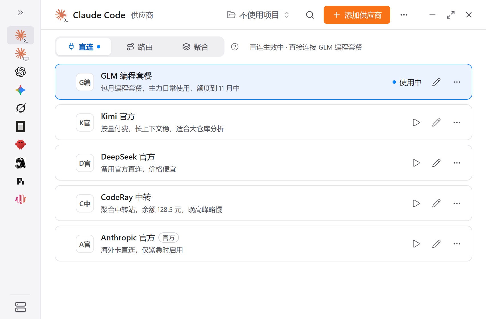</td>
<td>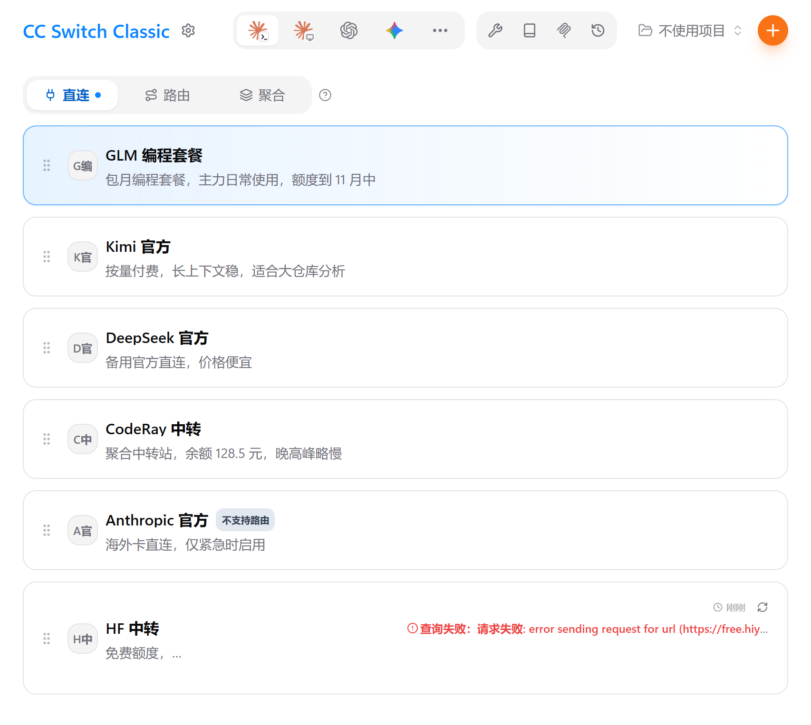</td>
</tr>
</table>

- **官方原版**：左侧应用侧栏 + 右侧详情，V4 的新布局，功能入口最多
- **Classic**：完整 V3 布局——顶部应用图标条、通栏卡片列表、`Ctrl+F` 浮动搜索

### ② 设置页

<table>
<tr>
<th width="50%">官方原版（V4 界面）</th>
<th width="50%">Classic（本仓库）</th>
</tr>
<tr>
<td>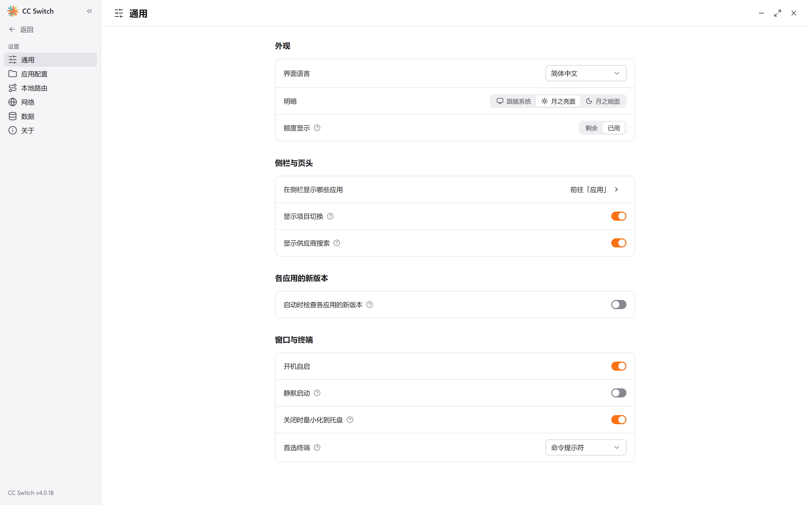</td>
<td>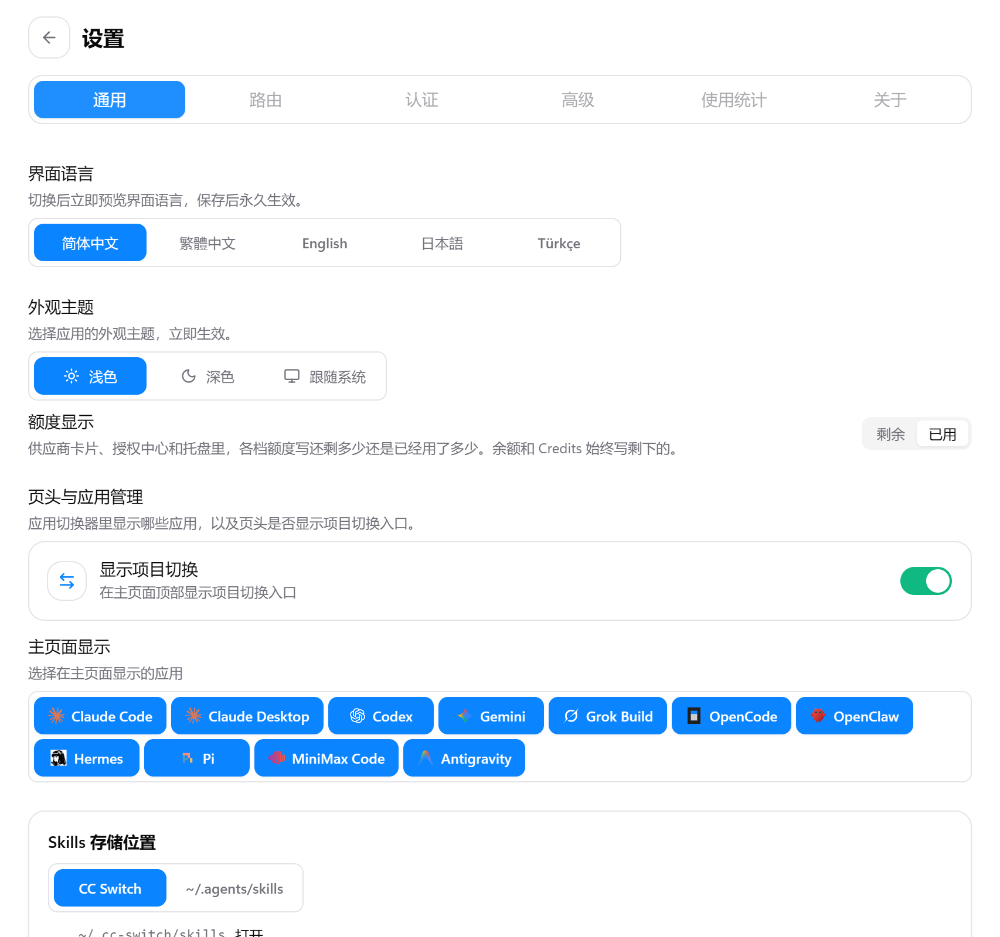</td>
</tr>
</table>

- **官方原版**：设置项按分组卡片纵向排布，设置分类在左侧栏
- **Classic**：V3 式横向分段页签 + 分段按钮，一屏浏览

### ③ 关于页

<table>
<tr>
<th width="50%">官方原版（V4 界面）</th>
<th width="50%">Classic（本仓库）</th>
</tr>
<tr>
<td>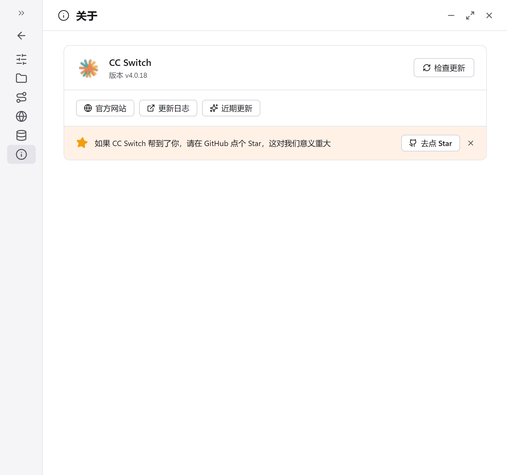</td>
<td>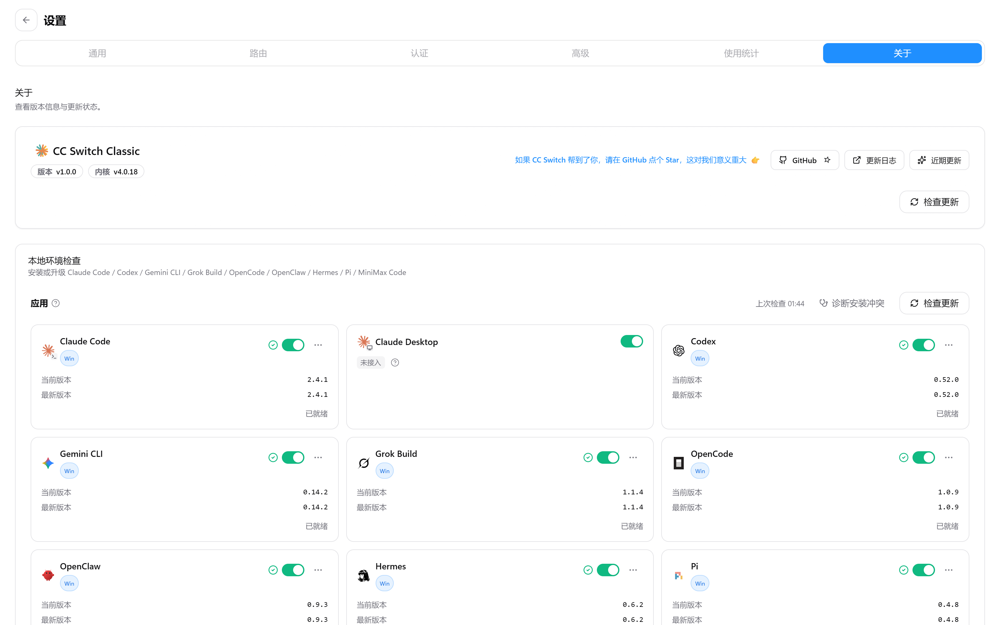</td>
</tr>
</table>

## 怎么选？

| 你想要 | 选它 |
|---|---|
| 原汁原味官方版，第一时间获得上游新功能 | [上游 V4 原版](https://github.com/farion1231/cc-switch/releases) |
| 和 V3 几乎一模一样的手感，内核还是新的 | ✅ **Classic（本仓库）**，[点此下载](https://github.com/jzcangshu/cc-switch-classic/releases/latest) |

## 下载与更新

1. 到 [Releases](https://github.com/jzcangshu/cc-switch-classic/releases/latest) 按平台下载：
   - **Windows x64**: `…-Windows-setup.exe`（安装版）/ `…-Windows-Portable.zip`（绿色版，解压即用）
   - **Windows ARM64**: `…-Windows-arm64-setup.exe` / `…-Windows-arm64-Portable.zip`
   - **Linux x64**: `…-Linux-x86_64.AppImage` / `.deb` / `.rpm`
   - **Linux ARM64**: `…-Linux-arm64.AppImage` / `.deb` / `.rpm`
   - **macOS**（universal，未签名）: `…-macOS-unsigned.dmg`（推荐）或 `…-macOS-unsigned.zip`
2. **macOS 未签名包**首次打开需在「系统设置 → 隐私与安全性」点击「仍要打开」放行；macOS 暂不支持应用内自动更新（Windows/Linux 安装版支持）。
3. 应用内的更新提示**只跟随 Classic 主版本号**（v1.x）；当官方 v4 版发布内核升级后，我们会尽快跟进并推送 Classic 版的更新。

## 与上游的关系

- **内核**：定期合并 [farion1231/cc-switch](https://github.com/farion1231/cc-switch) 的更新（当前内核 v4.0.18），供应商协议、会话管理等能力与上游同步
- **界面**：坚持 V3 经典样式，不随上游改版
- **反馈**：界面与 Classic 相关问题提到[本仓库 issues](https://github.com/jzcangshu/cc-switch-classic/issues)；内核功能问题建议先到[上游 issues](https://github.com/farion1231/cc-switch/issues) 搜索

## 开发

```bash
pnpm install
pnpm tauri dev      # 桌面应用开发模式
pnpm dev:renderer   # 仅前端（浏览器预览）
pnpm test:unit      # 前端单元测试
pnpm tauri build    # 打包
```

## License

本项目基于 [farion1231/cc-switch](https://github.com/farion1231/cc-switch)（MIT License, © Jason Young）二次开发，沿用 MIT 协议开源。感谢上游作者与社区。


## 🔗 LinuxDo 社区

<div align="center">
  <a href="https://linux.do" target="_blank">
    
  </a>
  <p>
    <a href="https://linux.do" target="_blank"><strong>LinuxDo 社区</strong></a><br>
  </p>
    <p>@蕉灼の仓鼠</p>
    <p>本人长期活跃于L站;</p>
    <p>这里的人很好说话又好听;</p>
    <p>欢迎都来加入L站大家庭。 </p>

