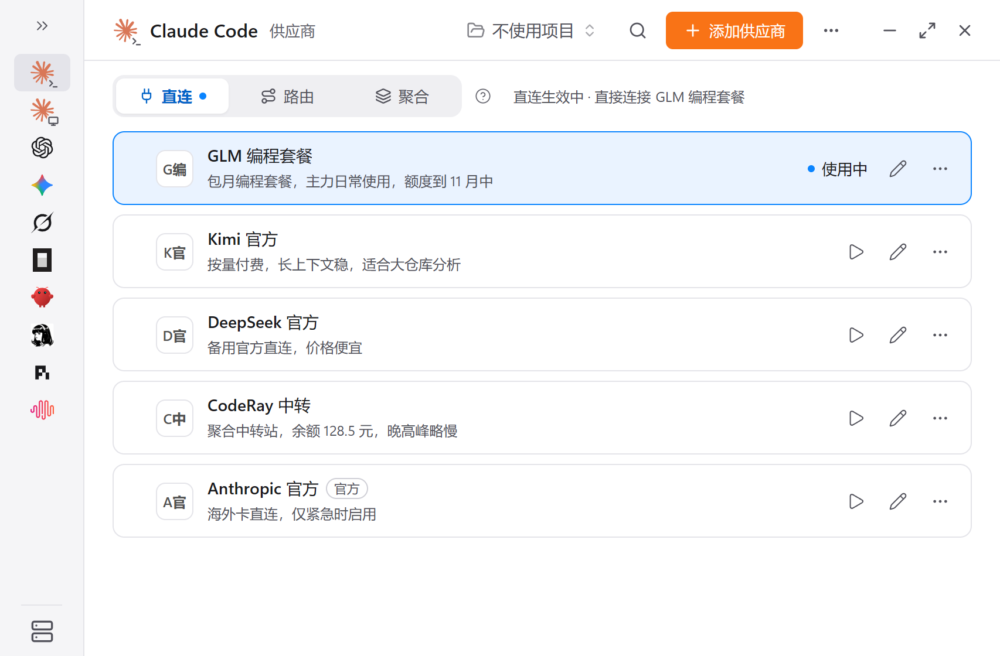
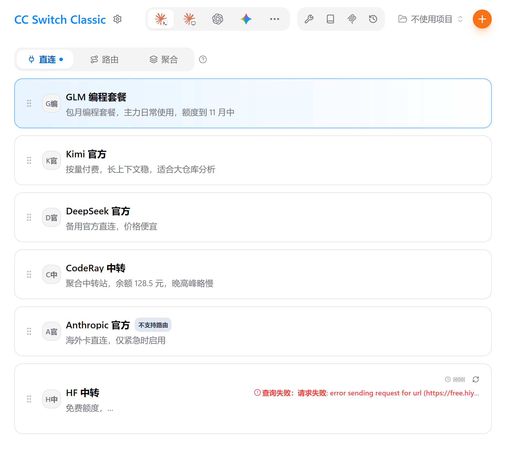
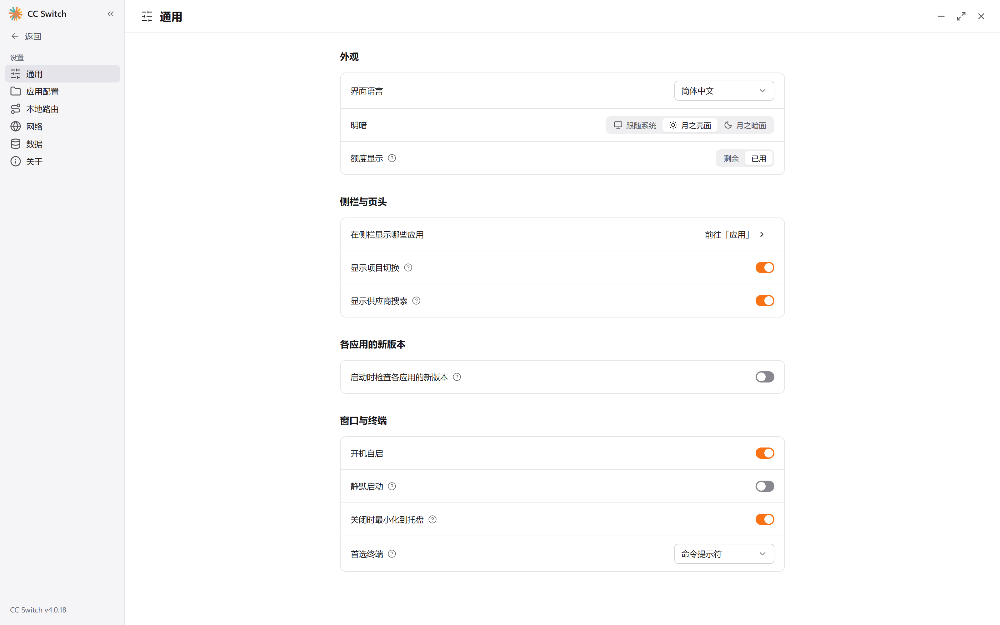
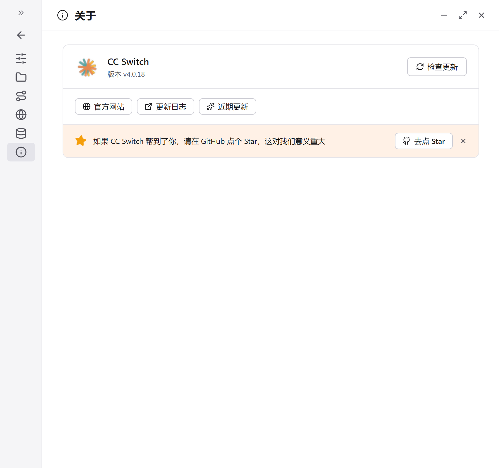

<div align="center">


# CC Switch Classic

**V3 经典界面 × V4 现代内核**

*Classic V3-style UI on the cc-switch V4 core.*

[](https://github.com/jzcangshu/cc-switch-classic/releases)
[](https://github.com/farion1231/cc-switch)
[](#license)
[](#下载与更新)

[下载最新版](https://github.com/jzcangshu/cc-switch-classic/releases/latest) · [更新日志](https://github.com/jzcangshu/cc-switch-classic/releases) · [上游项目](https://github.com/farion1231/cc-switch)

</div>

---

## 这是什么

[CC Switch](https://github.com/farion1231/cc-switch) 是一款管理 Claude Code / Codex 等 AI 编程工具供应商配置的桌面应用。官方 **V4 版**把界面全面改版成了侧栏布局。

**CC Switch Classic** 在**完全相同的 V4 内核**之上，把界面换回 V3 的经典样式——功能不缺，手感照旧。

两套界面长什么样、有什么区别，往下看图对比，挑一个顺手的用。

## 界面对比

以下截图均为真实程序界面，两个版本使用同一份数据，方便横向对比。

### ① 供应商首页

<table>
<tr>
<th width="50%">官方原版（V4 界面）</th>
<th width="50%">Classic（本仓库）</th>
</tr>
<tr>
<td></td>
<td></td>
</tr>
</table>

- **官方原版**：左侧应用侧栏 + 右侧详情，V4 的新布局，功能入口最多
- **Classic**：完整 V3 布局——顶部应用图标条、通栏卡片列表、`Ctrl+F` 浮动搜索

### ② 设置页

<table>
<tr>
<th width="50%">官方原版（V4 界面）</th>
<th width="50%">Classic（本仓库）</th>
</tr>
<tr>
<td></td>
<td></td>
</tr>
</table>

- **官方原版**：设置项按分组卡片纵向排布，设置分类在左侧栏
- **Classic**：V3 式横向分段页签 + 分段按钮，一屏浏览

### ③ 关于页

<table>
<tr>
<th width="50%">官方原版（V4 界面）</th>
<th width="50%">Classic（本仓库）</th>
</tr>
<tr>
<td></td>
<td></td>
</tr>
</table>

- Classic 的关于页**直接内嵌"本地环境检查"**，并显示双版本号：`版本 v1.0.0`（Classic 自己的）+ `内核 v4.0.18`（跟随上游）

## 怎么选？

| 你想要 | 选它 |
|---|---|
| 原汁原味官方版，第一时间获得上游新功能 | [上游 V4 原版](https://github.com/farion1231/cc-switch/releases) |
| 和 V3 几乎一模一样的手感，内核还是新的 | ✅ **Classic（本仓库）**，[点此下载](https://github.com/jzcangshu/cc-switch-classic/releases/latest) |

## 下载与更新

1. 到 [Releases](https://github.com/jzcangshu/cc-switch-classic/releases/latest) 下载：
   - `CC-Switch-Classic-v1.0.0-Windows-x64-Portable.zip` —— 免安装便携版，解压即用
   - `CC-Switch-Classic_4.0.18_x64-setup.exe` —— 安装版
2. 应用内的更新提示**只跟随 Classic 主版本号**（v1.x），不会把你引回官方 V4 界面版；内核升级会以 Classic 更新的形式一并发布。

## 与上游的关系

- **内核**：定期合并 [farion1231/cc-switch](https://github.com/farion1231/cc-switch) 的更新（当前内核 v4.0.18），供应商协议、会话管理等能力与上游同步
- **界面**：坚持 V3 经典样式，不随上游改版
- **反馈**：界面与 Classic 相关问题提到[本仓库 issues](https://github.com/jzcangshu/cc-switch-classic/issues)；内核功能问题建议先到[上游 issues](https://github.com/farion1231/cc-switch/issues) 搜索

## 开发

```bash
pnpm install
pnpm tauri dev      # 桌面应用开发模式
pnpm dev:renderer   # 仅前端（浏览器预览）
pnpm test:unit      # 前端单元测试
pnpm tauri build    # 打包
```

## License

本项目基于 [farion1231/cc-switch](https://github.com/farion1231/cc-switch)（MIT License, © Jason Young）二次开发，沿用 MIT 协议开源。感谢上游作者与社区。
